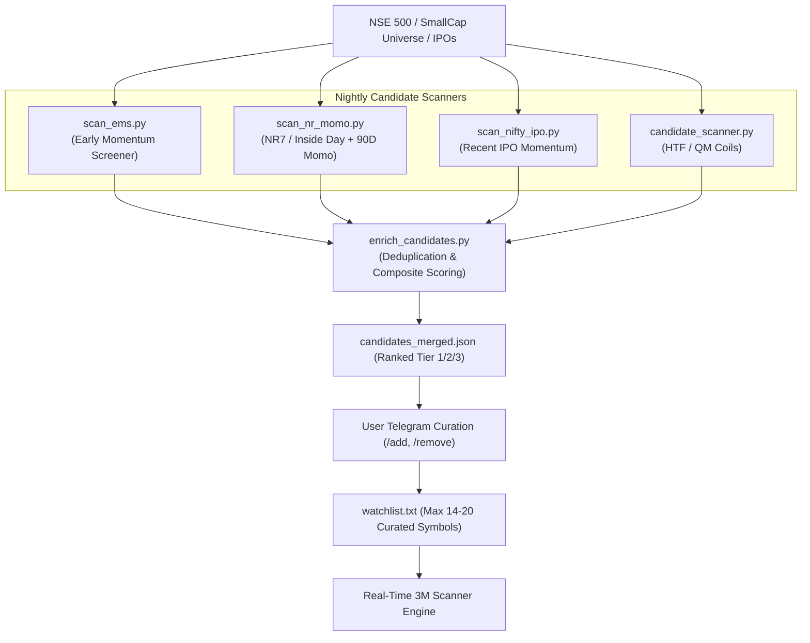
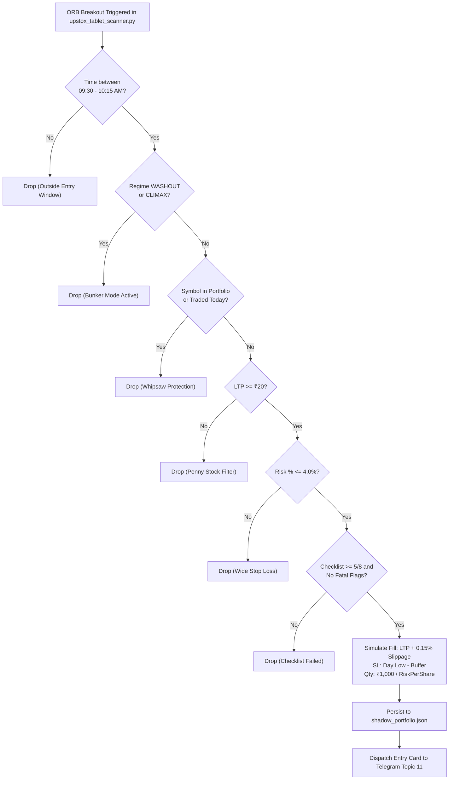
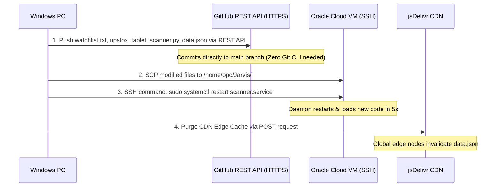

# 🏛️ JARVIS TRADING SYSTEM: MASTER ARCHITECTURE & SPECIFICATION MANUAL
**Document Version:** 3.0.0 (Autonomous Production & Phase 1 Specification)  
**Classification:** Complete System Engineering Blueprint  
**System Target:** Fully Autonomous 3M ORB Scanner, Positional Swing Engine, Multi-Broker Hub & Cloud Infrastructure  
**Author:** Jarvis Engineering Team & DeepMind Antigravity  
**Reconstruction Feasibility:** 100% (Complete Module-by-Module Technical Specification)

---

## 📑 TABLE OF CONTENTS
1. [Executive Overview & Trading Philosophy](#1-executive-overview--trading-philosophy)
2. [Global System Architecture & Hardware Topology](#2-global-system-architecture--hardware-topology)
3. [Broker API & Authentication Architecture](#3-broker-api--authentication-architecture)
4. [Universe & Watchlist Screening Pipelines](#4-universe--watchlist-screening-pipelines)
5. [Market Regime & Macro Breadth Engine](#5-market-regime--macro-breadth-engine)
6. [3-Minute Real-Time Scanner Engine (`upstox_tablet_scanner.py`)](#6-3-minute-real-time-scanner-engine)
7. [Strategy Rules & Position Sizing Engine (`order_engine.py`)](#7-strategy-rules--position-sizing-engine)
8. [Phase 1 Autonomous Swing Shadow Engine (`shadow_execution_engine.py`)](#8-phase-1-autonomous-swing-shadow-engine)
9. [Telegram Command & Interactive Routing Engine (`telegram_bot.py`)](#9-telegram-command--interactive-routing-engine)
10. [Pre-Market Sieve & EOD Hindsight Analytics](#10-pre-market-sieve--eod-hindsight-analytics)
11. [Front-End Terminal & Visualizer Architecture (`index.html`)](#11-front-end-terminal--visualizer-architecture)
12. [Cloud Synchronization & DevOps Automation (`sync_to_cloud.py`)](#12-cloud-synchronization--devops-automation)
13. [Complete Data Schemas & File Formats](#13-complete-data-schemas--file-formats)
14. [Zero-Code Reconstruction Blueprint](#14-zero-code-reconstruction-blueprint)

---

## 1. Executive Overview & Trading Philosophy

### 1.1 Core Mission
The **Jarvis Trading System** is an institutional-grade, hybrid intraday-to-swing algorithmic execution platform specifically calibrated for the Indian National Stock Exchange (NSE). It bridges technical momentum mechanics with strict quantitative risk controls, automating the entire trade lifecycle from pre-market screening to real-time 3-minute Opening Range Breakout (ORB) detection, multi-day trailing stops, trade reconciliation, and hindsight performance audit.

### 1.2 Mathematical & Technical Philosophy
Jarvis synthesizes two prominent trading methodologies:
1. **Kristjan Qullamaggie High Tight Flag (HTF) / Episodic Pivot (EP) / 3M ORB:**
   - Entering momentum leaders during the 09:30–10:15 AM IST window as volatility contracts and price breaks above opening ranges or previous day highs.
   - Micro-risk structural invalidation using Day Low (LOD) stops buffered by Average True Range (ATR).
   - Riding multi-day and multi-week swing runners along the 10 EMA and 20 EMA while aggressively capturing outsized gains (up to 30% profit cap).
2. **Pradeep Bonde (Stockbee) Market Breadth Regime Framework:**
   - Capital allocation is dynamically governed by underlying market participation rather than index price alone.
   - The ratio of daily 4% gainers to 4% losers, short-term word counts, and percentage of stocks trading above 20, 50, and 200 EMAs govern whether the engine operates in **EXPANSION (100% allocation)**, **CHOP / NEUTRAL (50% allocation)**, or **DEFENSIVE / WASHOUT (0% allocation / Cash Bunker Mode)**.

### 1.3 Operational Modes
- **Phase 1: 30-Day Autonomous Benchmark Engine (`shadow_execution_engine.py`)**:
  - Starts November 20, 2026.
  - Standardized ₹1,000 INR (1.0R) risk per trade.
  - Multi-day position holding across 30 evaluation sessions.
  - Zero manual intervention required; hands-free execution and automated daily scoreboard published to Telegram Topic 11 (`reports`) at 15:35:00 IST.
- **Phase 2: Live Multi-Broker Execution Hub (`order_engine.py` & `multi_broker_backend.py`)**:
  - Live order routing across Upstox, Zerodha (Kite Connect), and DhanHQ.
  - Interactive two-way Telegram trade execution (`/buy`, `/exit`) with visual risk previews and bracket order safeguards.

---

## 2. Global System Architecture & Hardware Topology

```mermaid
flowchart TD
    subgraph Local_Workstation ["Windows Master Workstation"]
        LocalFiles["watchlist.txt / config_credentials.json"]
        SyncCloud["sync_to_cloud.py / GitHub API"]
        LocalJournal["Journal.xlsx (Sync & Reconcile)"]
    end

    subgraph OCI_Cloud ["Oracle Cloud Always-Free VM (80.225.210.222)"]
        ScannerDaemon["scanner.service (upstox_tablet_scanner.py)"]
        ShadowEngine["shadow_execution_engine.py (Phase 1)"]
        OrderEngine["order_engine.py (Checklist & Sizing)"]
        TGBot["telegram_bot.py (Polling Daemon)"]
        BreadthEngine["intraday_breadth_monitor.py"]
    end

    subgraph External_Cloud ["External Services & Brokers"]
        GitHub["GitHub Repository (sanIncredible/Jarvis@main)"]
        UpstoxAPI["Upstox API v2 (WebSocket + REST)"]
        ZerodhaAPI["Zerodha Kite Connect"]
        DhanAPI["DhanHQ v2 API"]
        TelegramCloud["Telegram Bot API (Group: 5066630232)"]
        Dashboard["GitHub Pages (sanincredible.github.io/Jarvis/)"]
    end

    LocalFiles -->|Push via REST API / SSH| GitHub
    LocalFiles -->|Direct SCP & SSH| OCI_Cloud
    ScannerDaemon <-->|LTP Feed (Protobuf)| UpstoxAPI
    ScannerDaemon --> ShadowEngine
    ScannerDaemon --> OrderEngine
    ScannerDaemon --> TGBot
    ScannerDaemon -->|Atomic data.json write| GitHub
    GitHub --> Dashboard
    TGBot <-->|Commands & Topic Alerts| TelegramCloud
    OrderEngine -.->|API Orders| ZerodhaAPI
    OrderEngine -.->|API Orders| DhanAPI
```

### 2.1 Host Specifications
- **Master Development Workstation:** Windows 11 PC, Python 3.11/3.12, primary storage for local configurations, Excel trading journals, and SSH deployment keys.
- **Production Server:** Oracle Cloud Infrastructure (OCI) Compute Instance:
  - OS: Oracle Linux / CentOS 8 (x86_64 or aarch64)
  - Public IP: `80.225.210.222`
  - SSH User: `opc` (Authentication via RSA key: `ssh-key-2026-09-21_new.key`)
  - Remote Directory: `/home/opc/Jarvis/`
  - Python Environment: `/usr/bin/python3` with system packages and user site-packages.

### 2.2 Systemd Daemons on OCI
1. **`scanner.service`** (Primary Autonomous Daemon):
   - Path: `/etc/systemd/system/scanner.service`
   - Command: `/usr/bin/python3 -u /home/opc/Jarvis/upstox_tablet_scanner.py`
   - User: `opc`
   - Restart Policy: `always`, `RestartSec=10`
   - Responsibilities: Runs the real-time 3-minute ORB cycle, manages the Telegram polling thread, runs the shadow execution engine, watches trailing stops, and schedules EOD reports.
2. **`jarvis-auth.service`** (OAuth Callback Server):
   - Path: `/etc/systemd/system/jarvis-auth.service`
   - Command: `/usr/bin/python3 -u /home/opc/Jarvis/auth_callback_server.py`
   - Purpose: Listens on local port `8080` for Upstox OAuth redirect callbacks (`http://localhost:8080/callback`).
3. **`jarvis-tunnel.service`** (Cloudflare Tunnel Daemon):
   - Path: `/etc/systemd/system/jarvis-tunnel.service`
   - Exposes local callback servers securely to the public internet for OAuth handshake completion.

---

## 3. Broker API & Authentication Architecture

### 3.1 Upstox API v2 OAuth Lifecycle
- **Base Endpoint:** `https://api.upstox.com/v2`
- **Authentication URL:**
  ```
  https://api.upstox.com/v2/login/authorization/dialog?response_type=code&client_id={API_KEY}&redirect_uri={REDIRECT_URI}
  ```
- **Code Exchange (`POST /v2/login/authorization/token`):**
  - Payload: `code`, `client_id`, `client_secret`, `redirect_uri`, `grant_type=authorization_code`.
  - Response: `{ "access_token": "...", "extended_token": "..." }`.
- **Token Persistence:**
  - Token string is stored in `upstoxtoken.txt` and merged into `config_credentials.json` under `cfg["upstox"]["access_token"]`.
  - Daily validity: Upstox access tokens expire at 03:30 AM IST every morning.
  - Pre-flight check: Before 09:14 AM IST, the scanner tests the token by fetching live quotes for `NSE_EQ|INE002A01018` (RELIANCE). If invalid, a notification is dispatched to Telegram Topic 2469 (`token_refresh`).

### 3.2 Zerodha Kite Connect Lifecycle
- **Base Endpoint:** `https://api.kite.trade`
- **Exchange:** Request token exchanged with `api_secret` hash (`SHA-256(api_key + request_token + api_secret)`).
- **Auto-Login Flow (`multi_broker_backend.py`):** Uses user ID, password, and TOTP secret (via `pyotp`) to automate browserless session token renewal.

### 3.3 DhanHQ v2 API Lifecycle
- **Base Endpoint:** `https://api.dhan.co/v2`
- **Token Duration:** 30-day JWT lifespan.
- **Watchdog Engine (`telegram_bot.py` / `renew_dhan.py`):**
  - Daily automated test fetches fund margins (`GET /v2/margincalculator`).
  - Warning alert triggered if token has $\le 2$ days remaining.
  - Auto-renewal can be triggered via `/renew_dhan` command.

---

## 4. Universe & Watchlist Screening Pipelines

The watchlist lifecycle ensures only institutional-grade setups reach the active 3-minute scanner.



### 4.1 Candidate Screening Engines
1. **Early Momentum Screener (`scan_ems.py`):**
   - Filters for stocks making 90-day highs with daily turnover $> ₹10\text{ Cr}$.
   - Volume acceleration: Today's volume $\ge 1.5\times$ 20-day moving average.
2. **Narrow Range Momentum (`scan_nr_momo.py`):**
   - Detects **NR7** (current daily high-low range is the narrowest of the last 7 sessions).
   - Detects **Inside Days** (High $\le$ Prev High and Low $\ge$ Prev Low).
   - Identifies volatility contraction preceding explosive directional expansion.
3. **Nifty IPO Screener (`scan_nifty_ipo.py`):**
   - Monitors stocks listed within the last 365 trading days.
   - Requires price within 15% of all-time high with institutional accumulation signatures.
4. **Enrichment & Composite Scoring (`enrich_candidates.py`):**
   - Merges candidates into `candidates_merged.json`.
   - Scoring Formula:
     $$\text{Total Score} = \text{Tier Score} + \text{Volume Score} + \text{Momentum Score} + \text{Sector Score} + \text{Cross-List Bonus}$$
   - Cross-List Bonus: Stocks qualifying in multiple independent scanners receive $+15$ points per additional list.

### 4.2 Active Watchlist Architecture (`watchlist.txt`)
- Plain text file listing uppercase NSE symbols, one per line.
- Curation Authority: The user curates the final watchlist (typically 12–16 stocks) via Telegram commands (`/add SYMBOL`, `/remove SYMBOL`).
- **Master Authority Rule:** Local Windows/Telegram updates take absolute precedence; OCI and GitHub sync without overwriting local human edits.

---

## 5. Market Regime & Macro Breadth Engine

### 5.1 Pradeep Bonde (Stockbee) Breadth Framework
Implemented in [`intraday_breadth_monitor.py`](file:///c:/ProjectDir/intraday_breadth_monitor.py) and [`breadth_ledger_parser.py`](file:///c:/ProjectDir/breadth_ledger_parser.py).

#### Core Breadth Indicators
- **4% Gainers vs. 4% Losers:** Number of liquid NSE stocks gaining $>+4.0\%$ vs. declining $<-4.0\%$ in a session.
- **Breadth Ratio:** $\text{Ratio} = \frac{\text{Count}(>+4\%)}{\text{Count}(<-4\%)}$.
- **25% Gainers in 1 Month:** Measure of speculative appetite and sustained institutional trends.
- **Moving Average Breadth:** % of stocks above 20 EMA, 50 SMA, and 200 SMA.

### 5.2 Regime Classification State Machine
Stored in `market_regime.json`:

| Regime Code | Market Condition | Breadth Criteria | Swing Allocation % | Action Mandate |
| :--- | :--- | :--- | :---: | :--- |
| **EXPANSION** | Strong Bull Trend | $4\%\text{ Gainers} > 2.5\times 4\%\text{ Losers}$, Ratio $> 2.0$ | **100%** | Full aggressive swing entries allowed |
| **NORMAL** | Healthy Trend | Positive net breadth, above 20 EMA | **100%** | Standard 1.0R risk positioning |
| **NEUTRAL** | Rangebound / Chop | Gainers $\approx$ Losers, choppy indices | **50%** | Half-size positions; tight stop requirements |
| **DEFENSIVE** | Deteriorating Breadth | $4\%\text{ Losers} > 4\%\text{ Gainers}$, Index below 20 EMA | **0%** | Cash preservation; new long entries blocked |
| **WASHOUT / CLIMAX** | Panic Liquidation | Massive $4\%\text{ Losers} > 150$, Waterfall decline | **0%** | Absolute bunker mode; existing stops ratcheted |

---

## 6. 3-Minute Real-Time Scanner Engine

**File:** [`upstox_tablet_scanner.py`](file:///c:/ProjectDir/upstox_tablet_scanner.py) (Length: ~3,958 lines)

### 6.1 Market Lifecycle State Machine
Governed by `get_next_market_event(now_ist)`:
```
09:00:00 - 09:08:00 IST -> PRE_OPEN           (NSE Pre-Market Auction)
09:08:00 - 09:14:00 IST -> BUFFER_WARMUP      (Token check, network sync)
09:14:00 IST           -> AUTO-TRIGGER WARMUP (Pre-flight health check, watchlist load)
09:15:00 - 09:18:00 IST -> ORB_FORMING        (First 3-minute candle formation)
09:18:00 - 10:15:00 IST -> ORB_PRIME_WINDOW   (Core breakout & Phase 1 entry window)
10:15:00 - 15:15:00 IST -> MIDDAY_MONITORING  (Surveillance & trailing stop ratchet)
15:15:00 - 15:30:00 IST -> MARKET_CLOSE       (Final session pricing)
15:35:00 IST           -> EOD_REPORT_DISPATCH (Phase 1 Scoreboard & Hindsight report)
15:35:00+ IST          -> EOD_SLEEP           (Deep sleep until 09:14:00 next market day)
```

### 6.2 Data Ingestion & WebSocket Feed
- **WebSocket Daemon (`upstox_websocket_feed.py`):**
  - Connects to Upstox Market Data Feed v2 via Protobuf binary stream.
  - Subscribes to all active watchlist symbols via instrument keys (`NSE_EQ|ISIN`).
  - Updates in-memory dictionary `g_live_quotes[symbol]` every 2 seconds:
    - `ltp`, `day_high`, `day_low`, `day_open`, `volume`, `v_change`.
- **REST Polling Fallback:**
  - If WebSocket connection drops, automatically falls back to `/v2/market-quote/quotes` batch endpoint.

### 6.3 3-Minute Candle Aggregator Algorithm
`aggregate_1m_to_3m(candles_1m, target_date=None)`:
- Upstox API provides 1-minute historical candles: `[timestamp, open, high, low, close, volume, open_interest]`.
- **Target Date Filtering:** Strictly discards candles where `timestamp.date() != target_date` to prevent yesterday's closing candles from contaminating morning ORB calculations.
- Groups 1-minute candles into 3-minute intervals:
  - $\text{Open}_{3m} = \text{Open}_{1m,\text{start}}$
  - $\text{High}_{3m} = \max(\text{High}_{1m})$
  - $\text{Low}_{3m} = \min(\text{Low}_{1m})$
  - $\text{Close}_{3m} = \text{Close}_{1m,\text{end}}$
  - $\text{Volume}_{3m} = \sum(\text{Volume}_{1m})$

### 6.4 Opening Range Breakout (ORB) Status Logic
The first 3-minute candle (09:15–09:18 AM IST) establishes:
- $\text{ORB High} = \text{High}_{\text{candle } 0}$
- $\text{ORB Low} = \text{Low}_{\text{candle } 0}$

Status Transition Rules:
- **`H` (Breakout):** $\text{LTP} > \text{ORB High}$
- **`L` (Breakdown):** $\text{LTP} < \text{ORB Low}$
- **`L➔H` (Reversal Breakout):** Stock previously traded below $\text{ORB Low}$ but has surged and broken above $\text{ORB High}$.
- **`H➔L` (Reversal Breakdown):** Stock previously traded above $\text{ORB High}$ but failed and dropped below $\text{ORB Low}$.
- **`IN` (Inside Range):** $\text{ORB Low} \le \text{LTP} \le \text{ORB High}$.

### 6.5 Indicator Formulae
- **Strong Start (SS):**
  $$\text{Strong Start} = (\text{Open} > \text{PrevClose}) \land (\text{Low} \ge \text{PrevClose} \times 0.995)$$
- **10 EMA Stretch %:**
  $$\text{Stretch \%} = \frac{\text{LTP} - \text{EMA}_{10}}{\text{EMA}_{10}} \times 100$$
- **Relative Volume (RVOL):**
  $$\text{RVOL} = \frac{\text{Cumulative Today's Volume}}{\text{Expected Volume for Elapsed Time based on 20-Day SMA}}$$

---

## 7. Strategy Rules & Position Sizing Engine

**File:** [`order_engine.py`](file:///c:/ProjectDir/order_engine.py) (Length: ~5,443 lines)

### 7.1 The 10-Point Strategy Checklist
Evaluated by `evaluate_strategy_checklist(symbol, quote_data, calc_data)`:

```
[1] Market Regime Permission:
    PASS if regime is EXPANSION / NORMAL / NEUTRAL.
    FAIL if regime is DEFENSIVE, DEFENSIVE_WATERFALL, CLIMAX, WASHOUT, or alloc_pct == 0.

[2] Dynamic ORB High Breakout:
    PASS if orb_status in ("H", "L➔H") OR ltp > orb_high.

[3] Previous Day High (PDH) Cleared:
    PASS if ltp > pdh OR pdh_broken == True.

[4] Strong Start (SS) Signature:
    PASS if (day_open > prev_close) AND (day_low >= prev_close * 0.995).

[5] Relative Volume (RVOL) Participation:
    PASS if rvol >= 1.0 (Institutional surge) or rvol >= 0.75 (Moderate).
    FAIL if rvol < 0.75 (Low volume trap).

[6] Stop Distance / LOD Risk Proximity:
    risk_pct = ((ltp - day_low) / ltp) * 100
    PASS if risk_pct <= 3.0% (Tight) or risk_pct <= 4.0% (Acceptable).
    FAIL if risk_pct > 4.0% (Excessive tail risk).

[7] 10 EMA Stretch / Overextension:
    stretch_pct = ((ltp - ema10) / ema10) * 100
    PASS if stretch_pct <= 0.6% (Prime coil) or stretch_pct <= 1.5% (Normal).
    FAIL (FATAL) if stretch_pct > 1.5% (Overextended chase trap).

[8] Previous Day Narrow Range (NR) & Volatility Contraction:
    PASS if prev_range_ratio <= 0.75 * ATR OR is_inside_day == True OR is_narrow_prev_day == True.

[9] Opening Gap Extension Check (Qullamaggie 2.5% Rule):
    gap_ext_pct = ((day_open - trigger_ref) / trigger_ref) * 100
    PASS if gap_ext_pct <= 2.5%.
    FAIL if gap_ext_pct > 2.5% (Wait for 3m shelf consolidation).

[10] Candle Range Quality / Upper Wick Trap Check:
    upper_wick_pct = (max(0.0, day_high - ltp) / (day_high - day_low)) * 100
    PASS if upper_wick_pct <= 40.0% (Solid close near high).
    FAIL (FATAL) if upper_wick_pct > 40.0% (Severe rejection / bull trap).
```

### 7.2 Position Sizing Architecture (`calculate_order_sizing`)

#### 1. Volatility-Adaptive Stop-Loss Buffer
Rather than placing stops directly at the raw Day Low (which gets hunted by market makers), Jarvis places stops buffered by intraday volatility:
$$\text{Adaptive Buffer} = \max\left(1.0, \text{round}\left(\frac{\text{ATR}_{14}}{6} \times 0.25\right), \text{round}(\text{Day Low} \times 0.0020)\right)$$
$$\text{Stop Loss} = \text{round\_to\_clean\_int}(\text{Day Low} - \text{Adaptive Buffer})$$

#### 2. Risk-Normalized Sizing (1.0R = ₹1,000 INR)
$$\text{Risk Per Share} = \text{LTP} - \text{Stop Loss}$$
$$\text{ATR Floor} = \text{ATR}_{14} \times 0.75$$
$$\text{Effective Risk Distance} = \max(\text{Risk Per Share}, \text{ATR Floor}, 1.0)$$
$$\text{Quantity} = \max\left(1, \left\lfloor \frac{\text{Target Risk INR (1000)}}{\text{Effective Risk Distance}} \right\rfloor\right)$$
> **Crucial Safeguard:** The ATR floor prevents explosive, oversized position sizing when a stock has an artificially tight 0.1% day range.

#### 3. Defensive Regime Auto-Cap
If the market breadth enters `DEFENSIVE` or `CHOP`, gross capital allocation per trade is automatically clamped to a maximum of **₹50,000 INR**, regardless of how small the risk distance is.

#### 4. "House Money" Pyramiding Equation
When pyramiding into an existing profitable holding:
$$\text{Unrealized PnL} = (\text{LTP} - \text{Entry Price}) \times \text{Holding Quantity}$$
$$\text{Max Risk Allowed} = \text{Unrealized PnL} \times 0.50$$
$$\text{Pyramid Quantity} = \left\lfloor \frac{\text{Max Risk Allowed}}{\text{LTP} - \text{Stop Loss}} \right\rfloor$$

---

## 8. Phase 1 Autonomous Swing Shadow Engine

**File:** [`shadow_execution_engine.py`](file:///c:/ProjectDir/shadow_execution_engine.py) (Length: ~936 lines)

### 8.1 Autonomous Execution Mandate
- **Start Date:** `2026-11-20` (30 consecutive trading days).
- **Execution Window:** Strictly **09:30:00 to 10:15:00 AM IST** (Monday through Friday).
- **Fixed Risk:** Standardized ₹1,000 INR per position.
- **Reporting Channel:** Telegram Topic 11 (`reports`).

### 8.2 Entry Qualification Pipeline


### 8.3 Multi-Day Swing Trailing Stop Hierarchy
The trailing engine runs continuously in a background surveillance worker, evaluating all active positions against multi-day momentum rules:

```
[Level 1: 30% Profit Cap Milestone]
IF Peak Gain >= +28% OR Highest R >= +8.0R:
    New SL = Entry Price * 1.25 (Lock +25% absolute gain)
    Rule = "🛡️ 30% PROFIT CAP (Lock +25% Gains)"

[Level 2: Parabolic 5 EMA Vertical Trail]
ELSE IF Highest R >= +4.0R AND EMA5 > 0:
    New SL = EMA5 * 0.995 (Trail tightly below 5 EMA)
    Rule = "⚡ PARABOLIC 5 EMA TRAIL"

[Level 3: Stage 4 Institutional Lock]
ELSE IF Highest R >= +3.0R:
    New SL = max(Entry Price + 2.0 * RiskPerShare, EMA10 * 0.992)
    Rule = "🎯 STAGE 4: +2.0R LOCKED (Riding 10 EMA)"

[Level 4: Stage 3 Breakeven Runner Protection]
ELSE IF Highest R >= +2.0R:
    New SL = max(Entry Price + 1.0 * RiskPerShare, EMA10 * 0.992)
    Rule = "🎯 STAGE 3: +1.0R LOCKED (Swing Runner Protected)"

[Level 5: Day-1 Spurt Shield]
ELSE IF Holding Days == 1 AND Peak Gain >= +4.5%:
    New SL = Entry Price * 1.002 (Ratchet to Breakeven +0.2%)
    Rule = "🚀 DAY-1 SPURT SHIELD (+4.5% Surge -> Breakeven)"

[Level 6: 10 EMA Swing Trail (Day 2+)]
ELSE IF Holding Days >= 2 AND Highest R >= +1.5R AND EMA10 > 0:
    New SL = EMA10 * 0.992
    Rule = "🟢 10 EMA SWING TRAIL"

[Level 7: 20 EMA Structural Base Trail (Day 3+)]
ELSE IF Holding Days >= 3 AND Highest R >= +1.0R AND EMA20 > 0:
    New SL = EMA20 * 0.990
    Rule = "🟢 20 EMA STRUCTURAL TRAIL"

[Baseline]
DEFAULT: Retain Initial Structural LOD Stop
```

### 8.4 Exit Simulation & Overnight Gap-Down Realism
- On Day 1: Stops are evaluated against live LTP (if trailed) or Session Day Low.
- On Day 2+: Any session breach of `current_sl` triggers an exit.
- **Overnight Gap-Down Slippage:** If a stock opens the day below the stop price:
  $$\text{Exit Price} = \min(\text{Day Open}, \text{LTP}, \text{Current SL}) \times 0.9985$$
  This prevents unrealistic paper trading profits by factoring in true market execution slippage.

### 8.5 Mathematical Performance Analytics
Computed daily at 15:35:00 IST by `get_shadow_analytics()`:
- **Win Rate %:** $\frac{\text{Total Wins}}{\text{Total Closed Trades}} \times 100$
- **Profit Factor:** $\frac{\sum \text{Realized Wins (in R)}}{\sum |\text{Realized Losses (in R)}|}$
- **Mathematical Expectancy:**
  $$\text{Expectancy } (R) = (P_{\text{win}} \times \overline{R}_{\text{win}}) - (P_{\text{loss}} \times \overline{R}_{\text{loss}})$$
- **Max Drawdown ($R$):** Peak-to-trough drop of cumulative closed $R$.

---

## 9. Telegram Command & Interactive Routing Engine

**File:** [`telegram_bot.py`](file:///c:/ProjectDir/telegram_bot.py) (Length: ~3,950 lines)

### 9.1 Multi-Topic Routing Architecture
The bot connects to Telegram Supergroup ID `5066630232` using distinct forum topics to keep alerts organized:

| Topic Name | Thread ID | Dedicated Function |
| :--- | :---: | :--- |
| **`orb_signals`** | `8` | Real-time 3-minute ORB breakouts, volume surges, coil detections |
| **`risk_trailing`**| `9` | Trailing stop adjustments, LOD risk warnings |
| **`orders`** | `10` | Interactive `/buy` & `/exit` execution confirmations |
| **`reports`** | `11` | **Phase 1 Autonomous Entries, Exits, 15:35 IST Scoreboard**, Pre-Market Briefing |
| **`token_refresh`**| `2469` | Upstox & Dhan token expiry warnings, OAuth renewal URLs |

### 9.2 Complete Telegram Command Reference

| Command | Arguments | Description |
| :--- | :--- | :--- |
| `/add` | `SYMBOL` | Adds symbol to active `watchlist.txt` and updates Cloud/GitHub |
| `/remove` | `SYMBOL` | Removes symbol from active `watchlist.txt` |
| `/watchlist` | — | Displays formatted table of all active symbols with LTP and ORB status |
| `/scan` | — | Forces an immediate manual re-scan of the active watchlist |
| `/portfolio` | — | Displays active open shadow swing positions with unrealized R & stops |
| `/regime` | — | Displays current Market Breadth regime and swing allocation percentage |
| `/buy` | `SYMBOL [MODE]` | Initiates interactive order sizing preview with inline confirmation buttons |
| `/exit` | `SYMBOL` | Initiates exit confirmation for held position |
| `/token_status`| — | Displays time-to-expiry and health for Upstox, Zerodha, and Dhan tokens |
| `/candidates` | — | Summarizes candidates across all screening lists |
| `/ems` | — | Displays top ranked Early Momentum Screener stocks |
| `/nr` | — | Displays Narrow Range (NR7 / Inside Day) consolidation candidates |
| `/momo90` | — | Displays 90-day momentum breakout candidates |
| `/nifty_ipo` | — | Displays IPO momentum universe |
| `/hindsight` | — | Generates on-demand hindsight review of today's best breakout opportunities |
| `/postmortem` | — | Analyzes closed trade efficiency and gives recommendations |
| `/preflight` | — | Runs deep system diagnostics across tokens, network, and files |

---

## 10. Pre-Market Sieve & EOD Hindsight Analytics

### 10.1 Pre-Market Morning Summary (`pre_market_summary.py`)
- Dispatched automatically at **09:14:00 AM IST** to Topic 11 (`reports`).
- Synchronizes the latest `Market Breadth V2.0.xlsm` workbook from OneDrive.
- Inspects NSE pre-open auction data (09:00–09:08 AM) for Nifty 50 and active watchlist stocks.
- **Gap Sieve Classification (`pre_open_gap_sieve.json`):**
  - Identifies gaps $>+2.5\%$ as "Chasing Traps" requiring shelf pullbacks.
  - Highlights controlled gaps ($+0.5\%$ to $+1.5\%$) opening inside the previous day range.

### 10.2 EOD Hindsight Review (`eod_hindsight_report.py`)
- Dispatched at **15:45:00 PM IST**.
- Simulates every watchlist stock as if it had broken out during the day to determine the **True Optimal Trade**.
- Computes **Execution Efficiency**:
  $$\text{Efficiency \%} = \frac{\text{Actual PnL Captured}}{\text{Max Theoretical Favorable Excursion (MFE)}} \times 100$$
- Updates rolling expectancy ledger (`hindsight_history.json`).

---

## 11. Front-End Terminal & Visualizer Architecture

### 11.1 Single-Page Application (`index.html` & `scanner_dashboard.html`)
- Standalone HTML5/JavaScript dashboard rendered via GitHub Pages: `https://sanincredible.github.io/Jarvis/`.
- Zero backend server required for viewing; loads state dynamically from `data.json`.
- **Cache-Busting Architecture:** Fetches data via:
  ```javascript
  const DATA_URL = `https://raw.githubusercontent.com/sanIncredible/Jarvis/main/data.json?_t=${Date.now()}`;
  ```
- **TradingView Lightweight Charts:** Embedded interactive candlestick charts with overlays for:
  - Opening Range High (ORB-H) and Low (ORB-L) lines.
  - Previous Day High (PDH) and Low (PDL).
  - 10 EMA, 20 EMA, and 50 SMA curves.
- **Audio Alerts & Visual Coils:** Web Audio API triggers acoustic chimes when a stock shifts into `H` (Breakout) status.

---

## 12. Cloud Synchronization & DevOps Automation

### 12.1 1-Click Sync Architecture (`sync_to_cloud.py`)
Provides continuous integration and deployment between the Windows Workstation and OCI VM.



---

## 13. Complete Data Schemas & File Formats

### 13.1 `config_credentials.json`
```json
{
  "upstox": {
    "api_key": "YOUR_UPSTOX_API_KEY",
    "api_secret": "YOUR_UPSTOX_API_SECRET",
    "redirect_uri": "http://localhost:8080/callback",
    "access_token": "YOUR_UPSTOX_JWT_TOKEN"
  },
  "dhan": {
    "client_id": "1000000000",
    "access_token": "YOUR_DHAN_JWT_TOKEN"
  },
  "zerodha": {
    "user_id": "AB1234",
    "api_key": "YOUR_ZERODHA_KEY",
    "api_secret": "YOUR_ZERODHA_SECRET",
    "totp_secret": "YOUR_BASE32_TOTP",
    "enctoken": "YOUR_ZERODHA_ENCTOKEN"
  },
  "telegram": {
    "enabled": true,
    "bot_token": "BOT_TOKEN",
    "chat_id": "5066630232",
    "group_id": "-1005066630232",
    "topics": {
      "orb_signals": 8,
      "risk_trailing": 9,
      "orders": 10,
      "reports": 11,
      "token_refresh": 2469,
      "tokens": 2469
    }
  },
  "github": {
    "username": "sanIncredible",
    "repo": "Jarvis",
    "branch": "main",
    "token": "YOUR_GITHUB_PAT"
  }
}
```

### 13.2 `shadow_portfolio.json` (Active Open Positions)
```json
{
  "ADANIPOWER": {
    "symbol": "ADANIPOWER",
    "entry_price": 540,
    "initial_sl": 526,
    "current_sl": 540,
    "target_price": 568,
    "risk_per_share": 14.0,
    "risk_pct": 2.59,
    "quantity": 71,
    "fixed_risk_inr": 994,
    "capital_invested": 38340,
    "entry_date": "2026-11-20",
    "entry_time": "09:34:12",
    "highest_ltp": 558,
    "highest_r": 1.28,
    "last_trail_rule": "🎯 STAGE 3: +1.0R LOCKED (Swing Runner Protected)",
    "holding_days": 1,
    "sa_regime": "EXPANSION",
    "trigger_name": "ORB Breakout",
    "checklist_note": "Checklist 8/8 Passed",
    "status": "OPEN"
  }
}
```

### 13.3 `shadow_trade_log.json` (Closed Benchmark Trades)
```json
[
  {
    "symbol": "SUNTV",
    "entry_date": "2026-11-20",
    "exit_date": "2026-11-24",
    "entry_time": "09:36:00",
    "exit_time": "14:15:00",
    "entry_price": 750,
    "exit_price": 795,
    "quantity": 50,
    "holding_days": 3,
    "realized_pnl_inr": 2250,
    "realized_r": 2.25,
    "peak_r": 2.8,
    "giveback_r": 0.55,
    "exit_reason": "🟢 10 EMA SWING TRAIL",
    "sa_regime": "EXPANSION",
    "trigger_name": "ORB Breakout"
  }
]
```

### 13.4 `data.json` (Real-Time Terminal Snapshot)
```json
{
  "last_updated": "2026-11-20 10:14:02",
  "market_regime": {
    "state_code": "EXPANSION",
    "state_label": "Expansion (Breadth Positive)",
    "swing_allocation_pct": 100
  },
  "stocks": [
    {
      "symbol": "ADANIPOWER",
      "ltp": 542.5,
      "day_open": 532.0,
      "day_high": 545.0,
      "day_low": 528.0,
      "prev_close": 530.0,
      "change_pct": 2.36,
      "volume": 4521000,
      "rvol": 1.45,
      "orb_high": 536.0,
      "orb_low": 528.0,
      "orb_status": "H",
      "pdh": 538.0,
      "pdl": 524.0,
      "pdh_broken": true,
      "is_ss": true,
      "ema10": 534.2,
      "ema20": 528.0,
      "stretch_pct": 1.55,
      "is_inside_day": false,
      "candles_3m": [
        {"time": "09:15", "open": 532.0, "high": 536.0, "low": 528.0, "close": 535.0, "volume": 850000}
      ]
    }
  ]
}
```

---

## 14. Zero-Code Reconstruction Blueprint

If the entire codebase were lost, the system can be reconstructed from scratch following these steps:

### Step 1: Environment & Directory Initialization
```bash
mkdir -p /home/opc/Jarvis
cd /home/opc/Jarvis
python3 -m venv venv
source venv/bin/activate
pip install upstox-client requests urllib3 websockets protobuf openpyxl python-dotenv
```

### Step 2: Implement Core Modules
1. **`config_credentials.json`**: Populate broker tokens, Telegram group ID (`5066630232`), and GitHub PAT.
2. **`watchlist.txt`**: Create with the 14 curated symbols.
3. **`upstox_websocket_feed.py`**: Implement the WebSocket listener parsing Upstox Protobuf packets and updating thread-safe quotes dictionary.
4. **`order_engine.py`**:
   - Write `evaluate_strategy_checklist()` implementing Rules 1 through 10.
   - Write `calculate_order_sizing()` implementing the ATR-floored ₹1,000 risk equation.
5. **`shadow_execution_engine.py`**:
   - Write `evaluate_and_record_shadow_entry()` with 09:30–10:15 window checks and $+0.15\%$ slippage.
   - Write `update_shadow_trailing_and_exits()` with the 7-level multi-day trailing stop hierarchy.
   - Write `generate_and_send_phase1_eod_report()` to dispatch the 15:35 IST scoreboard to Topic 11.
6. **`telegram_bot.py`**:
   - Implement long-polling daemon against `https://api.telegram.org/bot{token}/getUpdates`.
   - Wire command router for `/add`, `/remove`, `/watchlist`, `/scan`, `/portfolio`.
7. **`upstox_tablet_scanner.py`**:
   - Wire the 3-minute cycle loop and state machine (`get_next_market_event()`).
   - Implement `aggregate_1m_to_3m()` with strict `target_date` filter.
   - Implement background GitHub REST API file commit helper (`sync_file_to_github_api()`).

### Step 3: Configure Cloud Daemons
```bash
sudo cat << 'EOF' > /etc/systemd/system/scanner.service
[Unit]
Description=Upstox 3m ORB Scanner Cloud Engine
After=network.target

[Service]
Type=simple
User=opc
WorkingDirectory=/home/opc/Jarvis
ExecStart=/usr/bin/python3 -u /home/opc/Jarvis/upstox_tablet_scanner.py
Restart=always
RestartSec=10

[Install]
WantedBy=multi-user.target
EOF

sudo systemctl daemon-reload
sudo systemctl enable scanner.service
sudo systemctl restart scanner.service
```

### Step 4: Verification Checklist
- Run pre-flight check to verify 14/14 Upstox live quotes received.
- Verify Telegram Topic 11 receives the startup card.
- Confirm state transitions to `EOD_SLEEP` until 09:14:00 AM IST.

---
*End of Master Architecture & Specification Manual.*
