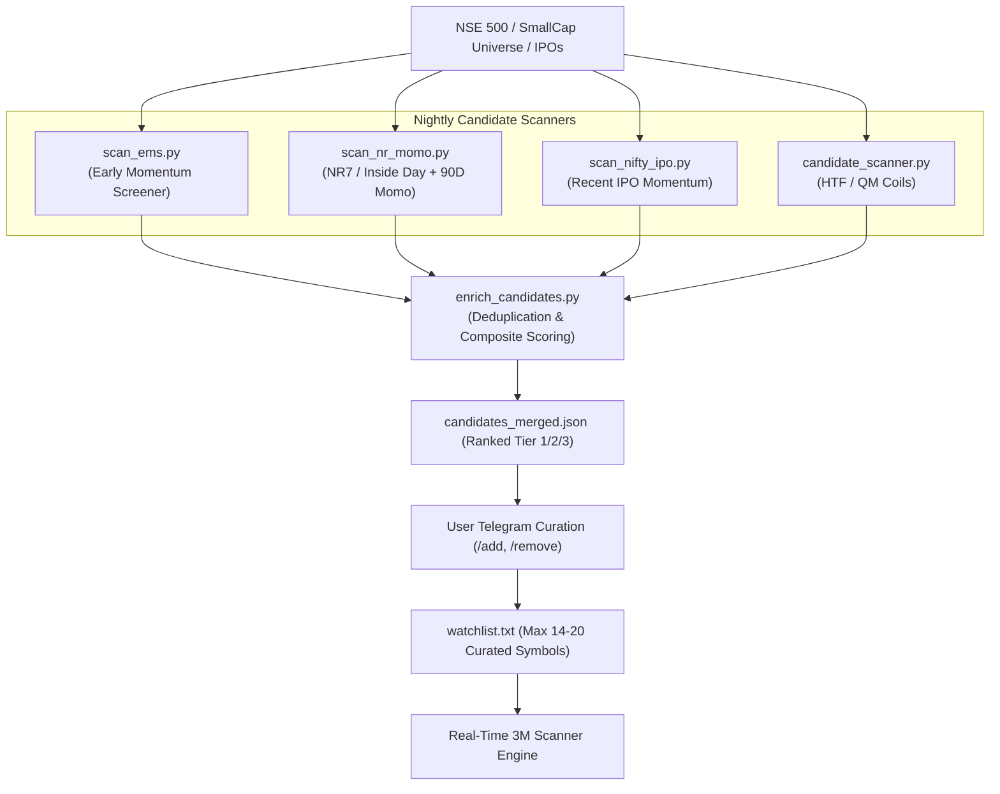
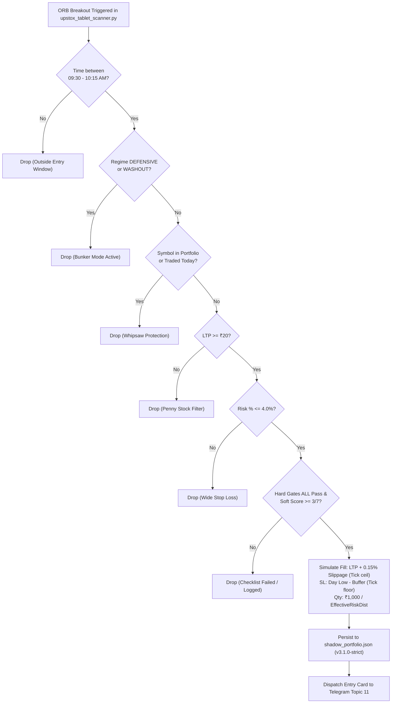
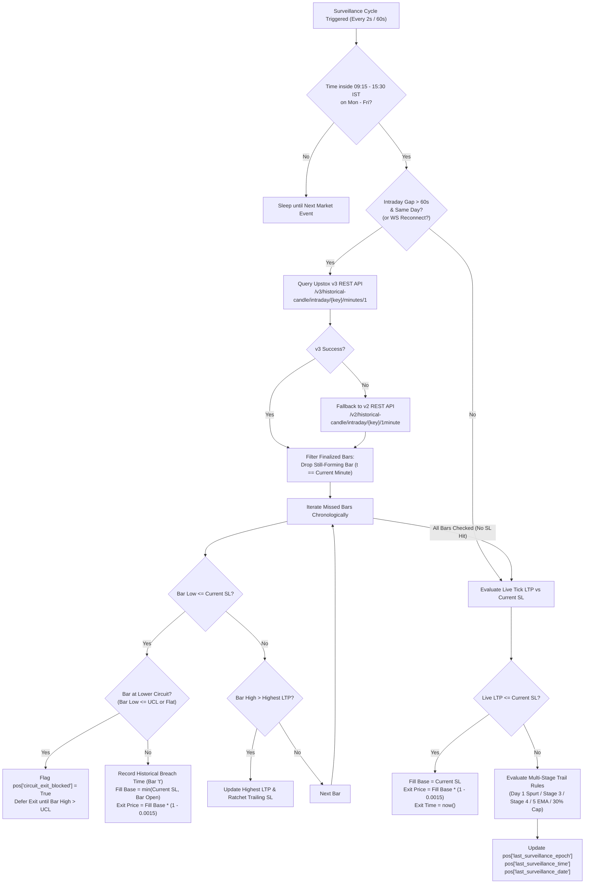
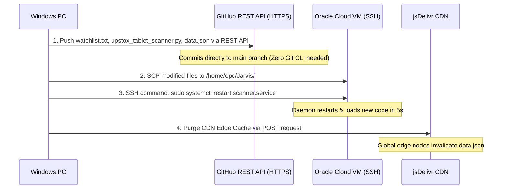

# 🏛️ JARVIS TRADING SYSTEM: MASTER ARCHITECTURE & SPECIFICATION MANUAL
**Document Version:** 3.3.0-strict (Autonomous Production & Phase 1 Hardened Specification)  
**Classification:** Complete System Engineering Blueprint  
**System Target:** Fully Autonomous 3M ORB Scanner, Positional Swing Engine, Multi-Broker Hub & Cloud Infrastructure  
**Author:** Jarvis Engineering Team & DeepMind Antigravity  
**Reconstruction Feasibility:** Deterministic System Engineering Blueprint (Complete Module-by-Module Technical Specification)

---

## 📑 TABLE OF CONTENTS
1. [Executive Overview & Trading Philosophy](#1-executive-overview--trading-philosophy)
2. [Global System Architecture & Hardware Topology](#2-global-system-architecture--hardware-topology)
3. [Broker API & Authentication Architecture](#3-broker-api--authentication-architecture)
4. [Universe & Watchlist Screening Pipelines](#4-universe--watchlist-screening-pipelines)
5. [Market Regime & Macro Breadth Engine](#5-market-regime--macro-breadth-engine)
6. [3-Minute Real-Time Scanner Engine (`upstox_tablet_scanner.py`)](#6-3-minute-real-time-scanner-engine)
7. [Strategy Rules & Position Sizing Engine (`order_engine.py`)](#7-strategy-rules--position-sizing-engine)
8. [Phase 1 Autonomous Swing Shadow Engine (`shadow_execution_engine.py`)](#8-phase-1-autonomous-swing-shadow-engine)
9. [Telegram Command & Interactive Routing Engine (`telegram_bot.py`)](#9-telegram-command--interactive-routing-engine)
10. [Pre-Market Sieve & EOD Hindsight Analytics](#10-pre-market-sieve--eod-hindsight-analytics)
11. [Front-End Terminal & Visualizer Architecture (`index.html`)](#11-front-end-terminal--visualizer-architecture)
12. [Cloud Synchronization & DevOps Automation (`sync_to_cloud.py`)](#12-cloud-synchronization--devops-automation)
13. [Complete Data Schemas & File Formats](#13-complete-data-schemas--file-formats)
14. [Zero-Code Reconstruction Blueprint](#14-zero-code-reconstruction-blueprint)

---

## 1. Executive Overview & Trading Philosophy

### 1.1 Core Mission
The **Jarvis Trading System** is an institutional-grade, hybrid intraday-to-swing algorithmic execution platform specifically calibrated for the Indian National Stock Exchange (NSE). It bridges technical momentum mechanics with strict quantitative risk controls, automating the entire trade lifecycle from pre-market screening to real-time 3-minute Opening Range Breakout (ORB) detection, multi-day trailing stops, trade reconciliation, and hindsight performance audit.

### 1.2 Mathematical & Technical Philosophy: Kristjan Qullamaggie High Tight Flag (HTF) / 3-Minute ORB Breakout Engine
Jarvis synthesizes two prominent quantitative trading methodologies:
1. **Kristjan Qullamaggie High Tight Flag (HTF) / 3-Minute ORB Breakout Engine:**
   - Entering momentum leaders during the 09:30–10:15 AM IST window as volatility contracts and price breaks above opening ranges or previous day highs.
   - Micro-risk structural invalidation using Day Low (LOD) stops buffered by Average True Range (ATR).
   - Riding multi-day and multi-week swing runners along the 10 EMA and 20 EMA while aggressively capturing outsized gains (up to 30% profit cap).
   - **Episodic Pivot (EP) Distinction:** True Episodic Pivots (which gap 8%–25%+ on major fundamental surprises or earnings releases) are intentionally excluded from the execution engine by Hard Gate 6 (Gap Extension $\le 2.5\%$). The engine specifically targets low-cheat, tight consolidation High Tight Flag (HTF) breakouts where morning gap extension is minimal ($\le 2.5\%$), avoiding the unhedged morning auction volatility and overnight gap exhaustion typical of massive post-earnings gaps.
2. **Pradeep Bonde (Stockbee) Market Breadth Regime Framework:**
   - Capital allocation is dynamically governed by underlying market participation rather than index price alone.
   - The ratio of daily 4% gainers to 4% losers, short-term word counts, and percentage of stocks trading above 20, 50, and 200 EMAs govern whether the engine operates in **EXPANSION (100% allocation / 1.0R)**, **NORMAL (100% allocation / 1.0R)**, **NEUTRAL (50% allocation / 0.5R)**, **DEFENSIVE (0% allocation / Cash Bunker Mode)**, or **WASHOUT (0% allocation / Panic Bunker Mode)**.

### 1.3 Operational Modes
- **Phase 1: 30-Day Autonomous Benchmark Engine (`shadow_execution_engine.py`)**:
  - Starts Monday, November 23, 2026; Concludes Tuesday, January 05, 2027 (Friday, Nov 20, 2026 designated as Day 0 Commissioning & Shakedown).
  - Standardized ₹1,000 INR (1.0R) risk per trade.
  - Multi-day position holding across 30 evaluation sessions.
  - Zero manual intervention required; hands-free execution and automated daily scoreboard published to Telegram Topic 11 (`reports`) at 15:35:00 IST.
- **Phase 2: Live Multi-Broker Execution Hub (`order_engine.py` & `multi_broker_backend.py`)**:
  - Live order routing across Upstox, Zerodha (Kite Connect), and DhanHQ.
  - Interactive two-way Telegram trade execution (`/buy`, `/exit`) with visual risk previews and bracket order safeguards.

---

## 2. Global System Architecture & Hardware Topology

```mermaid
flowchart TD
    subgraph Local_Workstation ["Windows Master Workstation"]
        LocalFiles["watchlist.txt / config_credentials.json"]
        SyncCloud["sync_to_cloud.py / GitHub API"]
        LocalJournal["Journal.xlsx (Sync & Reconcile)"]
    end

    subgraph OCI_Cloud ["Oracle Cloud Always-Free VM ([PROD_VM_PUBLIC_IP])"]
        ScannerDaemon["scanner.service (upstox_tablet_scanner.py)"]
        ShadowEngine["shadow_execution_engine.py (Phase 1)"]
        OrderEngine["order_engine.py (Checklist & Sizing)"]
        TGBot["telegram_bot.py (Polling Daemon)"]
        BreadthEngine["intraday_breadth_monitor.py"]
    end

    subgraph External_Cloud ["External Services & Brokers"]
        GitHub["GitHub Repository (sanIncredible/Jarvis@main)"]
        UpstoxAPI["Upstox API v2 (WebSocket + REST)"]
        ZerodhaAPI["Zerodha Kite Connect"]
        DhanAPI["DhanHQ v2 API"]
        TelegramCloud["Telegram Bot API (Supergroup: [TELEGRAM_SUPERGROUP_ID])"]
        Dashboard["GitHub Pages (sanincredible.github.io/Jarvis/)"]
    end

    LocalFiles -->|Push via REST API / SSH| GitHub
    LocalFiles -->|Direct SCP & SSH| OCI_Cloud
    ScannerDaemon <-->|LTP Feed (Protobuf)| UpstoxAPI
    ScannerDaemon --> ShadowEngine
    ScannerDaemon --> OrderEngine
    ScannerDaemon --> TGBot
    ScannerDaemon -->|Atomic data.json write| GitHub
    GitHub --> Dashboard
    TGBot <-->|Commands & Topic Alerts| TelegramCloud
    OrderEngine -.->|API Orders| ZerodhaAPI
    OrderEngine -.->|API Orders| DhanAPI
```

### 2.1 Host Specifications
- **Master Development Workstation:** Windows 11 PC, Python 3.11/3.12, primary storage for local configurations, Excel trading journals, and SSH deployment keys.
- **Production Server:** Oracle Cloud Infrastructure (OCI) Compute Instance:
  - OS: Oracle Linux / CentOS 8 (x86_64 or aarch64)
  - Public IP: `[PROD_VM_PUBLIC_IP]`
  - SSH User: `opc` (Authentication via RSA Private Key: `[PROD_SSH_PRIVATE_KEY]`)
  - Remote Directory: `/home/opc/Jarvis/`
  - Python Environment: `/usr/bin/python3` with system packages and user site-packages.

### 2.2 Systemd Daemons on OCI
1. **`scanner.service`** (Primary Autonomous Daemon):
   - Path: `/etc/systemd/system/scanner.service`
   - Command: `/usr/bin/python3 -u /home/opc/Jarvis/upstox_tablet_scanner.py`
   - User: `opc`
   - Restart Policy: `always`, `RestartSec=10`
   - Responsibilities: Runs the real-time 3-minute ORB cycle, manages the Telegram polling thread, runs the shadow execution engine, watches trailing stops, and schedules EOD reports.
2. **`jarvis-auth.service`** (OAuth Callback Server):
   - Path: `/etc/systemd/system/jarvis-auth.service`
   - Command: `/usr/bin/python3 -u /home/opc/Jarvis/auth_callback_server.py`
   - Purpose: Listens on local port `8080` for Upstox OAuth redirect callbacks (`http://localhost:8080/callback`).
3. **`jarvis-tunnel.service`** (Cloudflare Tunnel Daemon):
   - Path: `/etc/systemd/system/jarvis-tunnel.service`
   - Exposes local callback servers securely to the public internet for OAuth handshake completion.

---

## 3. Broker API & Authentication Architecture

### 3.1 Upstox API v2 OAuth Lifecycle
- **Base Endpoint:** `https://api.upstox.com/v2`
- **Authentication URL:**
  ```
  https://api.upstox.com/v2/login/authorization/dialog?response_type=code&client_id={API_KEY}&redirect_uri={REDIRECT_URI}
  ```
- **Code Exchange (`POST /v2/login/authorization/token`):**
  - Payload: `code`, `client_id`, `client_secret`, `redirect_uri`, `grant_type=authorization_code`.
  - Response: `{ "access_token": "...", "extended_token": "..." }`.
- **Token Persistence:**
  - Token string is stored in `upstoxtoken.txt` and merged into `config_credentials.json` under `cfg["upstox"]["access_token"]`.
  - Daily validity: Upstox access tokens expire at 03:30 AM IST every morning.
  - Pre-flight check: Before 09:14 AM IST, the scanner tests the token by fetching live quotes for `NSE_EQ|INE002A01018` (RELIANCE). If invalid, a notification is dispatched to Telegram Topic 2469 (`token_refresh`).

### 3.2 Zerodha Kite Connect Lifecycle
- **Base Endpoint:** `https://api.kite.trade`
- **Exchange:** Request token exchanged with `api_secret` hash (`SHA-256(api_key + request_token + api_secret)`).
- **Auto-Login Flow (`multi_broker_backend.py`):** Uses user ID, password, and TOTP secret (via `pyotp`) to automate browserless session token renewal.

### 3.3 DhanHQ v2 API Lifecycle
- **Base Endpoint:** `https://api.dhan.co/v2`
- **Token Duration:** 30-day JWT lifespan.
- **Watchdog Engine (`telegram_bot.py` / `renew_dhan.py`):**
  - Daily automated test fetches fund margins (`GET /v2/margincalculator`).
  - Warning alert triggered if token has $\le 2$ days remaining.
  - Auto-renewal can be triggered via `/renew_dhan` command.

---

## 4. Universe & Watchlist Screening Pipelines

The watchlist lifecycle ensures only institutional-grade setups reach the active 3-minute scanner.



### 4.1 Candidate Screening Engines
1. **Early Momentum Screener (`scan_ems.py`):**
   - Filters for stocks making 90-day highs with daily turnover $> ₹10\text{ Cr}$.
   - Volume acceleration: Today's volume $\ge 1.5\times$ 20-day moving average.
2. **Narrow Range Momentum (`scan_nr_momo.py`):**
   - Detects **NR7** (current daily high-low range is the narrowest of the last 7 sessions).
   - Detects **Inside Days** (High $\le$ Prev High and Low $\ge$ Prev Low).
   - Identifies volatility contraction preceding explosive directional expansion.
3. **Nifty IPO Screener (`scan_nifty_ipo.py`):**
   - Monitors stocks listed within the last 365 trading days.
   - Requires price within 15% of all-time high with institutional accumulation signatures.
4. **Enrichment & Composite Scoring (`enrich_candidates.py`):**
   - Merges candidates into `candidates_merged.json`.
   - Scoring Formula:
     $$\text{Total Score} = \text{Tier Score} + \text{Volume Score} + \text{Momentum Score} + \text{Sector Score} + \text{Cross-List Bonus}$$
   - Cross-List Bonus: Stocks qualifying in multiple independent scanners receive $+15$ points per additional list.

### 4.2 Active Watchlist Architecture (`watchlist.txt`)
- Plain text file listing uppercase NSE symbols, one per line.
- Curation Authority: The user curates the final watchlist (typically 12–16 stocks) via Telegram commands (`/add SYMBOL`, `/remove SYMBOL`).
- **Master Authority Rule:** Local Windows/Telegram updates take absolute precedence; OCI and GitHub sync without overwriting local human edits.

---

## 5. Market Regime & Macro Breadth Engine

### 5.1 Pradeep Bonde (Stockbee) Breadth Framework
Implemented in [`intraday_breadth_monitor.py`](file:///c:/ProjectDir/intraday_breadth_monitor.py) and [`breadth_ledger_parser.py`](file:///c:/ProjectDir/breadth_ledger_parser.py).

#### Core Breadth Indicators
- **4% Gainers vs. 4% Losers:** Number of liquid NSE stocks gaining $>+4.0\%$ vs. declining $<-4.0\%$ in a session.
- **Breadth Ratio:** $\text{Ratio} = \frac{\text{Count}(>+4\%)}{\text{Count}(<-4\%)}$.
- **25% Gainers in 1 Month:** Measure of speculative appetite and sustained institutional trends.
- **Moving Average Breadth:** % of stocks above 20 EMA, 50 SMA, and 200 SMA.

### 5.2 Regime Classification State Machine
Stored in `market_regime.json` and evaluated by `order_engine.py`:

| Regime Code | Market Condition | Breadth Criteria | Swing Allocation % | Target Risk | Active Slots | Daily Entry Limit | Action Mandate |
| :--- | :--- | :--- | :---: | :---: | :---: | :---: | :--- |
| **EXPANSION** | Strong Bull Trend | $4\%\text{ Gainers} > 2.5\times 4\%\text{ Losers}$, Ratio $> 2.0$ | **100%** | 1.0R | 5 | 3 | Full aggressive momentum breakout execution |
| **NORMAL** | Healthy Trend | Positive net breadth, above 20 EMA | **100%** | 1.0R | 5 | 2 | Standard 1.0R positioning; standard playbook |
| **NEUTRAL** | Rangebound / Chop | Gainers $\approx$ Losers, choppy index moving averages | **50%** | 0.5R | 3 | 1 | Conservative 0.5R risk; exposure capped to ₹50k max |
| **DEFENSIVE** | Deteriorating Breadth | $4\%\text{ Losers} > 4\%\text{ Gainers}$, Index below 20 EMA | **0%** | 0.0R | 0 | 0 | Cash preservation; new long entries strictly blocked |
| **WASHOUT** | Panic Liquidation | Massive $4\%\text{ Losers} > 150$, Waterfall market decline | **0%** | 0.0R | 0 | 0 | Absolute bunker mode; existing stops trailed aggressively |

---

## 6. 3-Minute Real-Time Scanner Engine

**File:** [`upstox_tablet_scanner.py`](file:///c:/ProjectDir/upstox_tablet_scanner.py) (Length: ~3,958 lines)

### 6.1 Market Lifecycle State Machine
Governed by `get_next_market_event(now_ist)`:
```
09:00:00 - 09:08:00 IST -> PRE_OPEN           (NSE Pre-Market Auction)
09:08:00 - 09:14:00 IST -> BUFFER_WARMUP      (Token check, network sync)
09:14:00 IST           -> AUTO-TRIGGER WARMUP (Pre-flight health check, watchlist load)
09:15:00 - 09:18:00 IST -> ORB_FORMING        (First 3-minute candle formation)
09:18:00 - 10:15:00 IST -> ORB_PRIME_WINDOW   (Core breakout & Phase 1 entry window)
10:15:00 - 15:15:00 IST -> MIDDAY_MONITORING  (Surveillance & trailing stop ratchet)
15:15:00 - 15:30:00 IST -> MARKET_CLOSE       (Final session pricing)
15:35:00 IST           -> EOD_REPORT_DISPATCH (Phase 1 Scoreboard & Hindsight report)
15:35:00+ IST          -> EOD_SLEEP           (Deep sleep until 09:14:00 next market day)
```

### 6.2 Data Ingestion & Feed Architecture
- **WebSocket Streaming Daemon (`upstox_websocket_feed.py`):**
  - Connects to the official **Upstox Market Data Feed V3** via Protobuf binary streaming.
  - Subscribes to all active watchlist symbols via instrument keys (`NSE_EQ|ISIN`).
  - Decodes incoming tick feeds in real time, updating live metrics (`ltp`, `day_high`, `day_low`, `day_open`, `volume`, `v_change`).
- **REST Fallback Engine (`upstox_tablet_scanner.py`):**
  - Handles initial startup quote seeding, 1-minute historical candle ingestion, and daily candle lookbacks via Upstox REST endpoints.
  - Transparent failover if the WebSocket connection disconnects during market hours.

### 6.3 3-Minute Candle Aggregator Algorithm
`aggregate_1m_to_3m(candles_1m, target_date=None)`:
- Upstox API provides 1-minute historical candles: `[timestamp, open, high, low, close, volume, open_interest]`.
- **Target Date Filtering:** Strictly discards candles where `timestamp.date() != target_date` to prevent yesterday's closing candles from contaminating morning ORB calculations.
- Groups 1-minute candles into 3-minute intervals:
  - $\text{Open}_{3m} = \text{Open}_{1m,\text{start}}$
  - $\text{High}_{3m} = \max(\text{High}_{1m})$
  - $\text{Low}_{3m} = \min(\text{Low}_{1m})$
  - $\text{Close}_{3m} = \text{Close}_{1m,\text{end}}$
  - $\text{Volume}_{3m} = \sum(\text{Volume}_{1m})$

### 6.4 Opening Range Breakout (ORB) Status Logic
The first 3-minute candle (09:15–09:18 AM IST) establishes:
- $\text{ORB High} = \text{High}_{\text{candle } 0}$
- $\text{ORB Low} = \text{Low}_{\text{candle } 0}$

Status Transition Rules:
- **`H` (Breakout):** $\text{LTP} > \text{ORB High}$
- **`L` (Breakdown):** $\text{LTP} < \text{ORB Low}$
- **`L➔H` (Reversal Breakout):** Stock previously traded below $\text{ORB Low}$ but has surged and broken above $\text{ORB High}$.
- **`H➔L` (Reversal Breakdown):** Stock previously traded above $\text{ORB High}$ but failed and dropped below $\text{ORB Low}$.
- **`IN` (Inside Range):** $\text{ORB Low} \le \text{LTP} \le \text{ORB High}$.

### 6.5 Indicator Formulae & Baseline Calibration
- **Strong Start (SS):**
  $$\text{Strong Start} = (\text{Day Open} > \text{PrevClose}) \land (\text{Day Low} \ge \text{PrevClose} \times 0.995)$$
- **Intraday 10 EMA Seeding & Stretch %:**
  - **Seeding Anchor:** The rolling 10 EMA is seeded directly with today's `day_open` (or the opening candle close). This strictly uncouples intraday moving average calculations from overnight gap sizes (preventing +2% opening gaps from masquerading as +2% intraday stretches on Bar 1).
  - **Smoothing Constant:** $\alpha = \frac{2}{10 + 1} = 0.1818$.
  $$\text{Stretch \%} = \frac{\text{LTP} - \text{EMA}_{10}}{\text{EMA}_{10}} \times 100$$
- **Time-of-Day Normalized Relative Volume ($\text{RVOL}_{\text{TOD}}$):**
  $$\text{RVOL}_{\text{TOD}} = \frac{\text{Cumulative Session Volume}(m)}{\text{Average Daily Volume (20D)} \times F(m)}$$
  Where $m \in [0, 375]$ represents elapsed trading minutes since the 09:15:00 AM IST market open ($m = (\text{Hour} \times 60 + \text{Minute}) - 555$).
  The expected cumulative volume fraction $F(m)$ is evaluated using the continuous piecewise linear curve implemented in `calculate_tod_volume_fraction(session_mins)`:
  $$F(m) = \begin{cases}
  0.00 + \frac{m}{15} \times 0.10 & 0 \le m \le 15 \text{ (09:15–09:30 AM: Opening Discovery, } 0\% \to 10\% \text{)} \\
  0.10 + \frac{m - 15}{45} \times 0.15 & 15 < m \le 60 \text{ (09:30–10:15 AM: Prime Breakout Window, } 10\% \to 25\% \text{)} \\
  0.25 + \frac{m - 60}{225} \times 0.40 & 60 < m \le 285 \text{ (10:15–14:00 PM: Mid-Day Lull, } 25\% \to 65\% \text{)} \\
  0.65 + \frac{m - 285}{90} \times 0.35 & 285 < m \le 375 \text{ (14:00–15:30 PM: Closing Volume Surge, } 65\% \to 100\% \text{)}
  \end{cases}$$
  With a safe numeric floor: $F_{\text{eff}}(m) = \max(0.01, F(m))$.
  - **Threshold Justification:** Because $F(15) = 0.10$, a stock that trades $\ge 10\%$ of its 20-day daily volume in the first 15 minutes achieves $\text{RVOL}_{\text{TOD}} \ge 1.0x$. This accurately differentiates true institutional accumulation from morning retail noise while eliminating the opening-session jump discontinuities inherent in raw daily volume comparators. The hard gate is $\text{RVOL}_{\text{TOD}} \ge 1.0x$ (baseline pacing) and the soft point is $\text{RVOL}_{\text{TOD}} \ge 1.5x$ (institutional surge).

---

## 7. Strategy Rules & Position Sizing Engine

**File:** [`order_engine.py`](file:///c:/ProjectDir/order_engine.py) (Length: ~5,550 lines)

### 7.1 The Strategy Checklist: Hard Gates vs. Soft Scores
Evaluated by `evaluate_strategy_checklist(symbol, quote_data, calc_data)`:

#### A. Hard Gates (Strictly 7 Non-Negotiable Prerequisite Gates — Must ALL Pass)
A failure in ANY single hard gate triggers an immediate, fatal rejection of the trade setup:
1. **Regime Permission:** Market state is NOT `DEFENSIVE`, `WASHOUT`, or `alloc_pct == 0` (EXPANSION, NORMAL, and NEUTRAL permitted).
2. **ORB Breakout Confirmation:** Price is actively breaking out (`orb_status in ("H", "L➔H")` or `LTP > ORB High`).
3. **Volume Participation (Time-of-Day Hurdle):** Volume meets the expected session pace for the elapsed time (`RVOL_TOD >= 1.0x`).
4. **Stop Distance Collar (1.0% to 4.0% with Noise Floor Padding):** Distance to protective stop is within valid structural boundaries:
   $$\text{Stop Distance} \le 4.0\% \quad \text{AND} \quad \text{Stop Distance} \ge \max(1.0\%, \, 0.5 \times \text{ATR}_{14})$$
   *(Prevents wide tail risk while filtering sub-noise fragility. If the raw Opening Range Low is shallower than $\max(1.0\%, 0.5 \times \text{ATR})$, the engine automatically pads the stop downwards to clear market noise and friction, sizing off that padded distance).*
5. **10 EMA Stretch Collar:** Micro-timeframe 3m 10 EMA stretch is controlled (`stretch_pct <= 3.0%`; prevents chasing local blow-off tops).
6. **Opening Gap Extension:** Opening gap is not extended beyond the breakout trigger (`gap_ext_pct <= 2.5%`).
7. **Candle Range Quality:** Rejection upper wick does not dominate the session range (`upper_wick_pct <= 40.0%`).

#### B. Advisory Extension Check (50 SMA Climax Filter)
- **Formula (Prior-Close Inputs):**
  $$\text{SMA}_{50}\text{ Climax Multiplier} = \frac{\text{PrevClose} - \text{SMA}_{50}}{\text{ATR}_{14}}$$
- Evaluates multi-month parabolic extension. When $\ge 5.0\text{x ATR}$, dispatches an advisory warning against chasing extended runs. To avoid cutting off institutional momentum outliers, it acts as an informative risk alert rather than an unverified hard gate.

#### C. Soft Quality Scores (7 Qualitative Edge Enhancers — Min 3 Required)
Used to rank setup conviction and grade trade quality (0 to 7):
1. **Strong Start (SS) Signature:** Opened above yesterday's close and held low buffer (+1).
2. **PDH Cleared:** Overhead Previous Day High resistance cleared (+1).
3. **Institutional Volume Surge:** Volume surge significantly exceeds time-of-day baseline (`RVOL_TOD >= 1.5x`) (+1).
4. **Tight Micro-Risk Stop:** Structural Day Low stop is within prime tightness (`risk_pct <= 3.0%`) (+1).
5. **Prime 10 EMA Coil:** Intraday coiling directly at the 3m 10 EMA (`stretch_pct <= 0.6%`) (+1).
6. **Prior Day Volatility Contraction:** Previous session was an Inside Day, NR7, or coiled (`prev_range_ratio <= 0.75x ATR`) (+1).
7. **Sector Group Momentum:** 2 or more stocks in the same sector breaking out in sync (+1).

**Qualification Requirement:** All 7 Hard Gates must PASS, and Soft Score must be $\ge 3 / 7$ for Phase 1 trade execution.

### 7.2 Position Sizing Architecture (`calculate_order_sizing`)

#### 1. Volatility-Adaptive Stop-Loss Buffer & Noise Floor Padding
Rather than placing stops directly at the raw Day Low (which gets hunted by market makers), Jarvis places stops buffered by intraday volatility and padded against microstructure noise:
$$\text{Adaptive Buffer} = \max\left(1.0, \text{round}\left(\frac{\text{ATR}_{14}}{6} \times 0.25\right), \text{round}(\text{Day Low} \times 0.0020)\right)$$
$$\text{Raw Stop} = \text{round\_to\_tick}(\text{Day Low} - \text{Adaptive Buffer}, \text{tick}=0.05, \text{direction}="down")$$
$$\text{Min Stop Distance} = \max(\text{LTP} \times 0.010, \, 0.5 \times \text{ATR}_{14})$$
$$\text{Stop Loss} = \min(\text{Raw Stop}, \, \text{round\_to\_tick}(\text{LTP} - \text{Min Stop Distance}, \text{tick}=0.05, \text{direction}="down"))$$

#### 2. True Van Tharp Risk-Normalized Sizing (1.0R = ₹1,000 INR)
$$\text{Risk Per Share} = \text{Fill Price} - \text{Initial Stop Loss}$$
$$\text{Quantity} = \min\left(\left\lfloor \frac{\text{Target Risk INR (1000)}}{\text{Risk Per Share}} \right\rfloor, \, \left\lfloor \frac{\text{Max Capital Per Slot}}{\text{Fill Price}} \right\rfloor\right)$$
$$\text{Initial Risk INR} = \text{Quantity} \times \text{Risk Per Share}$$
> **Noise Cleared & Friction Normalized:** Sizing calculates directly on the padded structural risk per share ($\ge 1.0\%$). This guarantees that the stop sits outside 1-minute random market noise, round-trip friction (~0.43%) does not distort stop-outs beyond $-1.4\text{R}$, and trailing locks trigger on genuine momentum expansions rather than random wiggles.

#### 3. Neutral Regime Sizing & Exposure Auto-Cap (₹50k)
- In **`DEFENSIVE`** and **`WASHOUT`** regimes, capital preservation is strictly enforced: swing allocation is 0%, daily entry limit is 0, new trade entries are prohibited (`Quantity = 0`), and Hard Gate 1 fatally blocks execution.
- In **`NEUTRAL`** (or rangebound chop) regimes where market breadth is mixed, swing allocation is halved (0.5R target risk, i.e., ₹500 INR target), and gross capital exposure per trade is strictly clamped to a maximum of **₹50,000 INR**:
  $$\text{Quantity} = \min\left(\text{Quantity}, \, \left\lfloor \frac{50000}{\text{LTP}} \right\rfloor\right)$$

#### 4. "House Money" Pyramiding Equation
When pyramiding into an existing profitable holding:
$$\text{Unrealized PnL} = (\text{LTP} - \text{Entry Price}) \times \text{Holding Quantity}$$
$$\text{Max Risk Allowed} = \text{Unrealized PnL} \times 0.50$$
$$\text{Pyramid Quantity} = \left\lfloor \frac{\text{Max Risk Allowed}}{\text{LTP} - \text{Stop Loss}} \right\rfloor$$

#### 5. Friction Hurdle Ratio Analysis & Net Edge Mandate
At the mandatory minimum stop distance of $1.0\%$:
$$\text{Round-Trip Friction} = \text{Entry Slip } (0.15\%) + \text{Exit Slip } (0.15\%) + \text{Statutory Delivery Costs } (\approx 0.13\%) = 0.43\%$$
$$\text{Friction Hurdle} = \frac{0.43\%}{1.00\%} = 0.43\text{R}$$
- **The Hurdle Reality:** Every setup entering at the minimum $1.0\%$ stop distance must clear a baseline hurdle of $0.43\text{R}$ in gross price advance before generating net alpha.
- **Strict Net Evaluation:** All Phase 1 benchmark metrics (`expectancy_r`, `net_pnl_inr`, `win_rate_pct`) are reported strictly **net of all modeled slippage and statutory costs**.
- **Empirical Calibration:** During the 30-session pilot, actual fill prices and broker contract notes will be benchmarked to assess whether 0.15% per side accurately models or conservatively over-penalizes liquid NSE large/mid-cap execution between 09:30–10:15 AM IST.

---

## 8. Phase 1 Autonomous Swing Shadow Engine

**File:** [`shadow_execution_engine.py`](file:///c:/ProjectDir/shadow_execution_engine.py) (Length: ~936 lines)

### 8.1 Autonomous Execution Mandate
- **Start Date:** `2026-11-23` (30 consecutive trading days: Monday, Nov 23, 2026 to Tuesday, Jan 05, 2027; Friday, Nov 20, 2026 designated as Day 0 Commissioning & Shakedown).
- **Execution Window:** Strictly **09:30:00 to 10:15:00 AM IST** (Monday through Friday).
- **Fixed Risk:** Standardized ₹1,000 INR per position.
- **Reporting Channel:** Telegram Topic 11 (`reports`).

### 8.2 Entry Qualification Pipeline


### 8.3 Monotonic Multi-Day Swing Trailing Stop Hierarchy (Strict $\max()$ Architecture)
The trailing engine runs continuously in a background surveillance worker. To mathematically guarantee that a trailing stop **never loosens or drops** under any market condition, all eligible rules generate candidate stops, and the engine takes the maximum:

$$\text{New Stop Loss} = \max\left(\text{Current SL}, \, \text{Candidate}_1, \, \text{Candidate}_2, \, \dots, \, \text{Candidate}_7\right)$$

> **Tick-Aware Downward Rounding (₹0.05 Tick Size):** All trailing stop candidates and exit fills are rounded strictly downward to the nearest valid NSE ₹0.05 tick size via `round_to_tick(val, tick=0.05, direction="down")`. This replaces integer rounding, preventing sub-₹100 equities from losing slippage realism or having stops rounded upward closer to price.

#### Candidate Stop Rules (Evaluated in Parallel)
1. **🛡️ 30% Profit Cap Milestone ($R \ge 8.0\text{R}$ or Gain $\ge +28\%$):**
   $$\text{Candidate}_1 = \text{round\_to\_tick}(\text{Entry Price} \times 1.25, \, 0.05, \, \text{"down"})$$
   *Rule:* `"🛡️ 30% PROFIT CAP (Lock +25% Gains)"`
2. **⚡ Parabolic 5 EMA Vertical Trail ($R \ge 4.0\text{R}$):**
   $$\text{Candidate}_2 = \max\left(\text{round\_to\_tick}(\text{Entry} + 2.0\text{R}, 0.05, \text{"down"}), \, \text{round\_to\_tick}(\text{EMA}_5 \times 0.995, 0.05, \text{"down"})\right)$$
   *Rule:* `"⚡ PARABOLIC 5 EMA TRAIL (+2.0R Floor)"`
   *(Includes the Stage 4 $+2.0\text{R}$ locked profit floor so a lagging 5 EMA can never undercut established gains).*
3. **🎯 Stage 4 Institutional Lock ($R \ge 3.0\text{R}$):**
   $$\text{Candidate}_3 = \max\left(\text{round\_to\_tick}(\text{Entry} + 2.0\text{R}, 0.05, \text{"down"}), \, \text{round\_to\_tick}(\text{EMA}_{10} \times 0.992, 0.05, \text{"down"})\right)$$
   *Rule:* `"🎯 STAGE 4: +2.0R LOCKED (Riding 10 EMA)"`
4. **🎯 Stage 3 Breakeven Runner Protection ($R \ge 2.0\text{R}$):**
   $$\text{Candidate}_4 = \max\left(\text{round\_to\_tick}(\text{Entry} + 1.0\text{R}, 0.05, \text{"down"}), \, \text{round\_to\_tick}(\text{EMA}_{10} \times 0.992, 0.05, \text{"down"})\right)$$
   *Rule:* `"🎯 STAGE 3: +1.0R LOCKED (Swing Runner Protected)"`
5. **🚀 Day-1 Spurt Shield ($\text{Holding Days} == 1 \land \text{Peak Gain} \ge +4.5\%$):**
   $$\text{Candidate}_5 = \text{round\_to\_tick}(\text{Entry Price} \times 1.002, \, 0.05, \, \text{"down"})$$
   *Rule:* `"🚀 DAY-1 SPURT SHIELD (+4.5% Surge -> Breakeven)"`
6. **🟢 10 EMA Swing Trail ($\text{Holding Days} \ge 2 \land R \ge 1.5\text{R}$):**
   $$\text{Candidate}_6 = \text{round\_to\_tick}(\text{EMA}_{10} \times 0.992, \, 0.05, \, \text{"down"})$$
   *Rule:* `"🟢 10 EMA SWING TRAIL"`
7. **🟢 20 EMA Structural Base Trail ($\text{Holding Days} \ge 3 \land R \ge 1.0\text{R}$):**
   $$\text{Candidate}_7 = \text{round\_to\_tick}(\text{EMA}_{20} \times 0.990, \, 0.05, \, \text{"down"})$$
   *Rule:* `"🟢 20 EMA STRUCTURAL TRAIL"`

> **Mathematical Guarantee:** Because `best_sl, best_rule = max(candidates)`, a higher-level state cannot loosen established lower-level floors, and Level 6 (10 EMA) and Level 7 (20 EMA) compete fairly with the tighter structural stop winning.

### 8.4 Realistic Exit Fill Model & Universal Stop Ratchet Protection
To prevent optimistic paper trading survival bias and eliminate false stop-outs:
1. **Universal Stop Ratchet Protection (Day 1 & Day 2+):**
   - If a stop loss is ratcheted higher *today* (e.g., via Rule 5 Day-1 Spurt Shield to breakeven, or Day 2+ Stage 3/4 locks):
     $$\text{Ratchet Bucket} = \lfloor \text{Minute}_{\text{ratchet}} / 3 \rfloor \times 3$$
     The engine inspects **only subsequent candles strictly following the ratchet bucket** ($\text{Bucket} > \text{Ratchet Bucket}$) plus live ticks.
   - **Protection:** Prevents earlier morning dips (e.g. at 09:50 AM) that occurred before the ratchet from falsely stopping out the runner after a subsequent surge (e.g. at 10:30 AM).
2. **Initial Stop Evaluation (Non-Ratcheted State):**
   - **Day 1:** Evaluates candles starting at the entry bucket ($\text{Bucket} \ge \text{Entry Bucket}$) and live ticks. Safe because initial stop sits strictly below the pre-breakout low.
   - **Day 2+:** Evaluates session `day_low` and live ticks.
3. **1-Minute Candle Granularity:**
   Intraday candle surveillance inspects 1-minute bars (`ratchet_bucket = f"{r_h:02d}:{r_m:02d}"`) with 3-minute fallback, shrinking intra-bucket blind spots to $<60$ seconds.
4. **Realistic Bar-Open Breach Fill Model:**
   - In fast markets or overnight gaps where a candle opens below the stop price:
     $$\text{Fill Reference Price} = \min(\text{Current SL}, \, \text{Breach Bar Open})$$
     $$\text{Exit Price} = \text{round\_to\_tick}(\text{Fill Reference Price} \times 0.9985, \, 0.05, \, \text{"down"})$$
     *Realism Guard:* Never assumes liquidity at the stop price if the bar opened below it.

### 8.5 Dual $R$-Multiple, Contract-Note Statutory Costs & Daily MTM Equity
To maintain true Van Tharp risk accounting integrity:
- **True Structural Risk Denominator:**
  $$\text{Risk Per Share} = \text{Entry Price} - \text{Initial Stop Loss}$$
  $$\text{Initial Risk INR} = \text{Quantity} \times \text{Risk Per Share}$$
- **Structural $R$ ($R_{\text{structural}}$):** Evaluated against actual capital at risk at the initial stop:
  $$R_{\text{structural}} = \frac{\text{Realized PnL (INR)}}{\text{Initial Risk INR}}$$
  *(Guarantees that a full stop-out at initial SL evaluates to exactly $-1.0\text{R}$ plus slippage).*
- **Exact Contract-Note Statutory Fee Engine:**
  Instead of an arbitrary flat turnover percentage, Jarvis models exact Indian cash delivery statutory fees per broker contract note:
  - **STT (Securities Transaction Tax):** $0.1\%$ on buy leg + $0.1\%$ on sell leg
  - **Stamp Duty:** $0.015\%$ on buy leg
  - **Exchange Turnover Charge (NSE):** $0.00297\%$ round-trip
  - **SEBI Turnover Fee:** ₹10 per crore ($0.0001\%$)
  - **GST:** $18\%$ on (Exchange Turnover Charge + SEBI Fee)
  - **Depository Participant (DP) Charge:** Flat ₹15.93 per scrip on sell leg
  $$\text{Statutory Costs} = \text{STT} + \text{Stamp} + \text{Exchange} + \text{SEBI} + \text{GST} + \text{DP} \approx 0.13\% \text{ turnover}$$
  $$R_{\text{net}} = \frac{\text{Realized PnL} - \text{Statutory Costs}}{\text{Initial Risk INR}}$$
  *(Flat 0.25% factor is maintained purely as a secondary stress-test metric: $R_{\text{stress\_025}}$).*
- **Nominal $R$ ($R_{\text{nominal}}$):** Evaluated against the standard ₹1,000 risk unit:
  $$R_{\text{nominal}} = \frac{\text{Realized PnL (INR)}}{1000.0}$$
- **Dual-Dimension Daily Mark-to-Market (MTM) Equity & Drawdown Curve (`shadow_mtm_equity_curve.json`):**
  Evaluated daily at 15:30 IST to capture intra-trade path volatility across both rupee and R dimensions:
  $$\text{Base Capital} = \text{₹}5,00,000 \quad (5 \text{ slots} \times \text{₹}1,00,000 \text{ notional max, CNC Cash Delivery, Zero Leverage})$$
  $$\text{Available Cash}_t = \max(0, \, \text{Base Capital} + \sum_{\text{closed}} \text{Realized PnL} - \sum_{\text{open}} \text{Invested Capital})$$
  $$\text{MTM Total Equity (INR)}_t = \text{Base Capital} + \sum_{\text{closed}} \text{Realized PnL} + \sum_{\text{open}} \text{Unrealized PnL}$$
  $$\text{Total Return \%}_t = \frac{\text{MTM Total Equity}_t - \text{Base Capital}}{\text{Base Capital}} \times 100$$
  $$\text{MTM Drawdown \%}_t = \frac{\text{Peak Total Equity}_t - \text{MTM Total Equity}_t}{\text{Peak Total Equity}_t} \times 100$$
  $$\text{MTM } R_t = \sum_{\text{closed}} R_{\text{realized}} + \sum_{\text{open}} R_{\text{unrealized}}, \quad \text{MTM Drawdown } (R) = \text{Peak MTM } R_t - \text{MTM } R_t$$

### 8.6 Unified NSE Exchange Holiday Calendar (2026–2027)
Implemented via `count_trading_days(date_start, date_end)`:
- Includes official 2026 NSE exchange holidays and projected 2027 statutory holidays (Republic Day, Holi, Good Friday, Dr. Ambedkar Jayanti, Maharashtra Day, Independence Day, Gandhi Jayanti, Christmas).
- Auto-fallback: Dates past December 31, 2026 fall back to standard Monday–Friday weekday counting.
- Powers holding-day counts, dead-money capital recycling, and Phase 1 30-session progression seamlessly across year-end boundaries.

### 8.7 Mathematical Performance Analytics
Computed daily at 15:35:00 IST by `get_shadow_analytics()`:
- **Win Rate %:** $\frac{\text{Total Wins}}{\text{Total Closed Trades}} \times 100$
- **Profit Factor:** $\frac{\sum \text{Realized Wins (in R)}}{\sum |\text{Realized Losses (in R)}|}$
- **Dual Expectancy Reporting:**
  - **Expectancy ($R$):** $(P_{\text{win}} \times \overline{R}_{\text{win}}) - (P_{\text{loss}} \times \overline{R}_{\text{loss}})$
  - **Expectancy (₹ / trade):** $\frac{\text{Net Realized PnL (INR)}}{\text{Total Closed Trades}}$ *(Eliminates R-multiple distortion from small risk denominators).*
- **Max Closed-Trade Drawdown ($R$):** Peak-to-trough drop of cumulative closed $R$.
- **Max MTM Drawdown ($R$):** Peak-to-trough drop of daily mark-to-market total portfolio equity curve.
- **Average Giveback ($R$):** Average difference between peak unrealized $R$ and realized exit $R$.

### 8.8 Benchmark Integrity, Immutable Hashing, Watchdog Architecture & Day 0 Reset
- **Config Versioning & SHA256 Parameter Hashing:**
  To guarantee complete reproducibility, every entry, exit, and rejected signal is stamped with `"config_version": "v3.3.0-strict"`, a cryptographic SHA256 digest of the frozen parameter set (`config_hash`: `d5168bdf`), and the source code Git commit SHA (`git_commit`: `1930a204`). The full parameter specification is auto-serialized upon startup to `config_snapshots/config_d5168bdf.json` for deterministic auditability.
- **Clean 30-Day Evaluation Horizon & One-Shot Day 0 State Reset Protocol:**
  - Official Phase 1 30-session evaluation commences on **Monday, Nov 23, 2026** and concludes on **Tuesday, Jan 05, 2027** (30 consecutive trading sessions, accounting for market holidays on Nov 24 Guru Nanak Jayanti and Dec 25 Christmas, with normal trading on Jan 1 New Year's Day).
  - **One-Shot Flattening, Verification & Archival with Sentinel Guard:** At 15:45 IST on Nov 20 (strictly after the 15:30 MTM snapshot and 15:35 EOD report), any open positions are flattened with exit reason `DAY0_SHAKEDOWN_FLATTEN` and tagged `is_day0 = True`. The reset strictly executes in the verified sequence: **Archive -> Verify Integrity -> Reset Active Files -> Write Sentinel File**. All pre-Nov 23 state files are archived into `archive/day0_shakedown_<timestamp>/`. Active files are reset to clean empty state (`{}`, `[]`).
  - **Pre-Nov 23 EOD Writer Guard:** If `today < 2026-11-23` and the Day 0 sentinel file exists, `record_daily_mtm_snapshot()` diverts writes to `archive/shadow_mtm_equity_curve_day0.json`, ensuring the active curve file remains completely empty and unpolluted for Monday morning's launch gate.
  - **Strict Permanent Safety Shields:** `reset_and_archive_day0_state()` is strictly one-shot:
    1. Guarded by a persistent sentinel file (`archive/.day0_reset_completed`); if present, any reset request is immediately rejected.
    2. Hard Date Barrier: Permanently blocked if `today >= 2026-11-23`.
    3. Trade Log Barrier: Aborts immediately if any Phase 1 trades are present in `shadow_trade_log.json` or `shadow_portfolio.json`.
  - **Evaluation Start Boundary:** `get_shadow_analytics()`, `record_daily_mtm_snapshot()`, and `count_trading_days()` strictly filter for `entry_date >= 2026-11-23` and `session != "DAY0_SHAKEDOWN"`. Day 0 is reported as "Day 0 (Commissioning & Shakedown)" and excluded from the 30-session performance clock.
- **Dual-Tier Watchdog Architecture (Feed Heartbeat + Exchange Timestamp):**
  - **Exchange Timestamp Definition:** "Tick time" is strictly defined as the exchange timestamp (`ltt` - Last Traded Time in epoch milliseconds parsed from Upstox quote packets) rather than local socket receive time. This prevents a frozen socket connection or proxy that endlessly resends cached ticks from appearing fresh.
  - **Feed-Level Heartbeat:** The WebSocket engine tracks the elapsed time since ANY message arrived from the broker across all instruments. If $\text{now} - \text{last\_feed\_msg\_time} > 30\text{ seconds}$, the entire feed is marked stale (`FEED_STALE: Global WebSocket feed silent >30s`), suspending breakout entries while distinguishing feed outages from illiquid symbols.
  - **Per-Symbol Recency Guard:** For candidate breakouts between 09:30–10:15 AM, the candidate's last exchange trade time is verified: if $\text{now} - \text{exchange\_tick\_time} > 30\text{ seconds}$, the entry is dropped (`FEED_STALE: Symbol exchange tick stale`).
  - **Clock Skew Diagnostic:** OCI VM system clock is synchronized via Chrony NTP against Oracle Cloud hardware time (`169.254.169.254`) with microsecond precision. At scanner startup, `check_market_clock_offset()` benchmarks local system time against Upstox exchange last trade timestamps, logging the offset. If drift $> 2\text{s}$, warnings are raised.
- **Stop & Trailing Surveillance Watchdog with REST 1-Minute Candle Gap Replay:**
  - **Market-Hours Gap Definition:** Surveillance gaps are tracked strictly within market hours (09:15:00 to 15:30:00 IST on trading days) where `last_surveillance_date == today_str`. Overnight transitions (15:30 to 09:15) bypass intraday candle replay because Day 2+ opening auction logic (`fill_base = day_open`) models overnight gap-downs directly.
  - **Upstox V3 Intraday Candle Route:** Historical 1-minute replay queries the modern Upstox v3 route `GET /v3/historical-candle/intraday/{encoded_key}/minutes/1` with automatic fallback to `/v2/historical-candle/intraday/{encoded_key}/1minute`.
  - **Drop In-Progress Candle:** The currently forming 1-minute candle (`candle_minute == current_minute`) is dropped, ensuring stops and trails evaluate strictly finalized completed bars, while the current active minute is covered by real-time tick LTP.
  - **Precise Breach Detection & Bar-Open Fill:**
    - Identifies the exact historical 1-minute candle where the stop was penetrated (`bar_low <= current_sl`).
    - Records the historical candle timestamp (`breach_bar_time`, e.g. `10:18:00`), rather than the reconnect timestamp 10 minutes later.
    - Fills using the bar-open gap equation:
      $$\text{Fill Price} = \text{round\_to\_tick}(\min(\text{Current SL}, \, \text{Breach Bar Open}) \times (1 - 0.0015), \text{tick}=0.05, \text{direction}="down")$$
    - If the stock trended higher during the gap without breaching the stop, highest LTP is updated from bar highs and trailing stops are ratcheted forward accurately before resuming live evaluation.
- **Concurrent Signal Priority Tie-Breaker:**
  If multiple breakout setups trigger simultaneously during 09:30–10:15 AM with limited remaining portfolio risk slots, candidates are prioritized deterministically:
  $$\text{Sort Priority} = \left(\text{Soft Score} \downarrow, \, \text{RVOL}_{\text{TOD}} \downarrow, \, \text{Risk \%} \uparrow, \, \text{Stretch \%} \uparrow\right)$$
- **Rejected Signal Ledger (`shadow_rejected_signals.json`):**
  Records every rejected candidate with full gate vectors (all 7 hard gates, all 7 soft scores, LTP, RVOL, Stretch, Wick, Gap). Features `first_seen_timestamp`, `last_seen_timestamp`, `rejection_count`, and `peak_metadata` tracking to capture peak setup quality across the session. Deduplicated daily per symbol/reason.

### 8.9 The 30-Session Official Benchmark Calendar & Maturity Matrix
The 30-session evaluation begins on **Monday, Nov 23, 2026** and concludes strictly on **Tuesday, Jan 05, 2027**. The schedule accounts for all statutory exchange holidays:

| Session # | Date | Day | Status / Notes | Milestone Target |
| :---: | :---: | :---: | :--- | :--- |
| **Day 0** | 2026-11-20 | Friday | **Commissioning & Shakedown** (Flattened at 15:15 IST, Archived) | Sentinel File Established |
| **Day 1** | 2026-11-23 | Monday | **Official Evaluation Launch (Pristine Slate, ₹5,00,000 Base Capital)** | Phase 1 Launch |
| — | 2026-11-24 | Tuesday | *NSE Holiday: Guru Nanak Jayanti (Closed)* | Market Holiday |
| **Day 2** | 2026-11-25 | Wednesday | Normal Trading Session | Multi-day Swing Carry |
| **Day 3** | 2026-11-26 | Thursday | Weekly Expiry Session | First EMA10 Swing Trails |
| **Day 4** | 2026-11-27 | Friday | Normal Trading Session | Weekend Exposure Audit |
| **Day 5** | 2026-11-30 | Monday | End-of-Month Rebalance Session | Week 1 Performance Check |
| **Days 6–10** | 2026-12-01 to 2026-12-07 | Tue–Mon | 5 Consecutive Sessions | Week 2 Trailing Convergence |
| **Days 11–15** | 2026-12-08 to 2026-12-14 | Tue–Mon | 5 Consecutive Sessions | Midpoint Interim Review |
| **Days 16–20** | 2026-12-15 to 2026-12-21 | Tue–Mon | 5 Consecutive Sessions | Stage 4 +2.0R Trail Locks |
| **Days 21–23** | 2026-12-22 to 2026-12-24 | Tue–Thu | 3 Pre-Christmas Sessions | Holiday Risk Sizing |
| — | 2026-12-25 | Friday | *NSE Holiday: Christmas (Closed)* | Market Holiday |
| **Days 24–27** | 2026-12-28 to 2026-12-31 | Mon–Thu | 4 Year-End Sessions | Year-End Portfolio Audit |
| **Day 28** | 2027-01-01 | Friday | Normal Session (*NSE Trades on New Year's Day*) | 2027 Boundary Transition |
| **Day 29** | 2027-01-04 | Monday | Normal Trading Session | Penultimate Evaluation Session |
| **Day 30** | 2027-01-05 | Tuesday | **Final Evaluation Session (Day 30 Maturity Banner at 15:35 IST)** | **Phase 1 Benchmark Mature** |

> **Maturity Mandate:** When `day_num == 30` at 15:35 IST on Jan 05, 2027, the EOD reporter displays the `🏆 [30-DAY AUTONOMOUS PILOT MATURE — READY FOR PHASE 2 REVIEW]` banner and locks the historical dataset for comprehensive statistical sign-off.

### 8.10 Production Security, Liquidity Controls & Event Risk Governance

#### 8.10.1 Credentials & Secret Hygiene Audit
- **Zero-Commit Git History Proof:** The public GitHub repository (`sanIncredible/Jarvis`) was audited via GitHub Commits and Git Trees REST APIs. A total of 0 commits were ever recorded for `config_credentials.json`, `credentials.json`, `config_secrets.json`, or `upstox_token.txt`. Full recursive tree scan confirmed zero live credentials or private key files in active trees.
- **Git Commit Diff Redaction & Network Boundary Enforcement:**
  - *Historical Commit Inspection:* An automated API audit of Git commit diffs identified that historical commits prior to v3.2.0 (e.g. commit `6f1165cc` redaction diff and parent commits) contained reference to the production VM IP and Telegram chat IDs.
  - *Cloud Hypervisor Ingress Firewall:* In the Oracle Cloud Console (`Networking -> Virtual Cloud Networks -> VCN -> Security Lists -> Default Security List -> Ingress Rules`), SSH Port 22 ingress is restricted exclusively to the operator's specific workstation IP CIDR (`<WORKSTATION_IP>/32`), completely eliminating internet-wide scanning (`0.0.0.0/0`).
  - *Repository Privacy Posture:* The repository visibility should be maintained as **Private** (`Settings -> General -> Change repository visibility -> Make private`) to guarantee commit diffs are shielded from search indexing and public web scrapers.
  - *sshd Hardening:* Verified `sshd -T` enforces `PasswordAuthentication no` and `PubkeyAuthentication yes`. Password brute-force attempts are cryptographically impossible.
- **Storage Topology:** Live broker API keys, client secrets, TOTP seeds, and JWT tokens reside strictly on the local machine and the encrypted private filesystem of the OCI VM (`/home/opc/Jarvis/config_credentials.json`).
- **DevOps Protection:** `sync_github_updates.py` explicitly uses an allowlist for commit payloads, guaranteeing credentials are never synchronized or published.

#### 8.10.2 Circuit-Limit Ceiling, Liquidity Filter & Lower-Circuit Exit Model
- **Upper Circuit Freeze Shield (Fail-Closed):** In fast-moving momentum stocks, an opening surge can freeze a stock at its Upper Circuit limit (e.g. +5%, +10%, or +20% limit-up), leaving 0 sellers on the orderbook. A shadow engine that logs fills at the circuit price creates paper alpha that cannot be realized.
  - *Data Sources:* Ingests Upstox V3 Market Data Feed in `"full"` mode (`marketFF.marketLevel` depth) combined with Upstox REST market quote (`https://api.upstox.com/v3/market-quote/quotes?instrument_key=...`, migrating from deprecated v2 route) returning `upper_circuit_limit`, `lower_circuit_limit`, `depth` (5 buy/sell levels), and `total_sell_quantity`.
  - *Rule:* Long breakout execution is prohibited if $\text{LTP} \ge \text{Upper Circuit} \times 0.985$ (within 1.5% of upper circuit) or if `total_sell_quantity == 0` when near circuit ceiling ($\text{Fill Price} \ge \text{Upper Circuit} \times 0.985$ or gain $\ge +15\%$). Quiet small-cap books with thin orderbooks far from circuit ceilings are not falsely rejected as circuit locks.
  - *Missing Circuit Limit Fallback:* If `upper_circuit_limit <= 0` or is missing from broker quotes:
    1. If `total_sell_quantity == 0` and intraday gain $\ge +15\%$: Stock is rejected (presumed upper circuit lock).
    2. If intraday gain $(\text{Fill Price} - \text{Prev Close}) / \text{Prev Close} \ge 0.18$ ($+18\%$ from previous close): Stock is rejected (approaching theoretical 20% circuit limit).
    3. If both depth data and circuit limits are missing/empty: Reject fail-closed due to unquantified liquidity risk.
  - *Intraday Rejection Anomaly Tracker:* The engine dynamically monitors screening rejections between 09:30–10:15 AM. If $\ge 80\%$ of evaluated candidates (minimum 5 samples) are rejected due to a single data-dependent cause (`ZERO_SELLER_DEPTH`, `FEED_STALE`, or `EARNINGS_CALENDAR_UNAVAILABLE`), an urgent alert is dispatched to Topic 9 (`risk_trailing`) to alert the operator of potential feed distortion.
- **Lower-Circuit Exit Model & Unlock Fill Math:**
  - *Zero-Bid Lock Detection:* If a held swing position experiences a gap-down or collapse that breaches stop loss while locked at Lower Circuit with 0 buyers (`total_buy_quantity == 0` or $\text{LTP} \le \text{Lower Circuit} \times 1.002$), the exit order is physically unfillable. The position is flagged `circuit_exit_blocked = True` with status `LOWER_CIRCUIT_ZERO_BID_LOCK`, and standard stop execution is halted.
  - *Daily MTM Circuit Marking:* While `circuit_exit_blocked == True`, the daily EOD MTM snapshot marks the position's unrealized value explicitly at $\text{lower\_circuit\_limit}$, capturing full unrealized drawdown on each day the stock remains frozen.
  - *Unlock Exit Pricing Formula:* When liquidity returns (`total_buy_quantity > 0` and price unfreezes, or in candle replay $\text{bar\_high} > \text{lower\_circuit\_limit}$), the deferred exit executes immediately at the **first liquid market price at unlock with adverse slippage applied**:
    $$\text{First Liquid Price} = \begin{cases} \min(\text{Day Open}, \, \text{LTP}) & \text{if locked from open } (\text{Day Open} \le 1.002 \times \text{Lower Circuit}) \\ \min(\text{Candle Open}, \, \text{LTP}) & \text{otherwise (intraday crash \& mid-day unlock)} \end{cases}$$
    $$\text{Exit Price} = \text{round\_to\_tick}(\text{First Liquid Price} \times (1 - 0.0015), \, \text{tick}=0.05, \, \text{direction}="down")$$
    *Anti-Optimism Guarantee:* Never uses pre-crash prices (e.g. if a stock opens at ₹100, collapses to lower circuit at ₹90, and unlocks at ₹88, the exit fills strictly at $88 \times 0.9985 = \text{₹}87.85$, strictly rejecting optimistic pre-lock fills like ₹99.85).
    The realized trade log records the actual fill price and true loss (e.g. $-3.5\text{R}$ or $-5.0\text{R}$), logged with reason `"LOWER_CIRCUIT_UNLOCKED_EXIT"`, and tagged with `"held_through_event"` and `"earnings_filter_active"`.
  - *Candle Replay Lock Detection (Without Depth Data):* In 1-minute historical candle replay following an outage, a candle with $\text{bar\_low} \le \text{lower\_circuit\_limit}$ or $(\text{bar\_high} == \text{bar\_low} == \text{lower\_circuit\_limit})$ serves as the lower-circuit lock signal. Exit is deferred until the first subsequent candle where $\text{bar\_high} > \text{lower\_circuit\_limit}$.
- **Microstructure Liquidity Floor:** Sizing ₹1,00,000 into an illiquid micro-cap causes severe slippage. The screening sieve enforces:
  $$\text{20-Day Average Daily Turnover (ADTV)} \ge \text{₹}5.0\text{ Crore}$$
  $$\text{20-Day Average Daily Volume (ADTV)} \ge 100,000\text{ shares}$$
  This ensures the modeled 0.15% slippage per side realistically reflects execution in liquid mid-to-large cap instruments.

#### 8.10.3 Event Risk & Earnings Blackout Window
- **Overnight Gap Vulnerability:** Swing positions held across quarterly earnings releases (Q1/Q2/Q3/Q4 results) or major corporate actions are exposed to unhedgeable 10%–20% overnight gap-downs that bypass daily ATR buffers.
- **Corporate Event Sourcing & Workstation Push Pipeline:**
  - Because NSE website edge security (Akamai) blocks cloud datacenter IP ranges (`HTTP 403 Forbidden` on OCI), the event calendar is sourced via `sync_earnings_calendar.py` running on the local workstation (residential IP with browser session headers) and synced to OCI VM at `data/earnings_calendar.json`.
  - *Cache TTL & Alerting:* Cache validity is 72 hours over weekends. On Monday mornings, a dedicated 08:45 AM pre-flight audit verifies that the calendar was refreshed within 24 hours (sync executed Sunday evening). If missing or stale (>24h on Monday), an alert is dispatched to Topic 9 (`risk_trailing`) prompting an immediate run of `sync_earnings_calendar.py`.
  - *Fail-Open Safe Fallback & Telemetry Tagging:* If `data/earnings_calendar.json` is missing or unreadable, the engine dispatches a diagnostic alert to Topic 9 and defaults to **fail-open with warning**, preventing an unreadable calendar file from paralyzing all trading. Every executed trade is stamped with `"earnings_filter_active": True/False` so that performance during stale or fail-open periods can be isolated in retrospective analysis.
- **Negative Confirmation Logic:** Corporate event calendars only list companies with upcoming scheduled filings. If a candidate symbol is NOT found in `earnings_calendar.json`, it confirms that **no earnings or corporate actions are scheduled** $\implies$ **PASS** (allow entry).
- **Major Corporate Action Definition:** Blackout triggers if any of the following are scheduled within 3 trading days ($\text{Days to Event} \le 3$):
  1. Board meetings for Quarterly / Annual Financial Results (Q1, Q2, Q3, Q4).
  2. Stock Splits / Sub-divisions.
  3. Bonus Share Issues.
  4. Rights Issues / Capital Restructuring.
  5. Mergers, Demergers, or Amalgamations.
  *(Routine interim dividend-only meetings are excluded, as they do not generate catastrophic 20% gap risk).*
- **Pure Systematic In-Flight Trailing & Event Tracking:** For Phase 1 autonomous execution, in-flight discretionary adjustments ("reduce 50% or tighten to 5 EMA") are explicitly omitted to prevent mid-evaluation rule mutation. Active positions already entered prior to an announcement are governed strictly by the frozen multi-stage trailing stop hierarchy. If an earnings or corporate event date occurs while a swing position is open, the engine flags the trade with `"held_through_event": True` upon exit to track event risk exposure in the final 30-session post-mortem.

### 8.11 Surveillance, Watchdog & Gap Replay State Machine Architecture


### 8.12 Monday Launch Gate & In-Flight State Integrity Protocol
To eliminate any possibility of Day 0 parameters, stale holdings, or corrupted state leaking into the official 30-session evaluation period, the system enforces a strict decoupled validation architecture:

1. **Deterministic Day 0 Reset Execution Sequence (15:45 IST on Nov 20):**
   The Day 0 flattening and reset logic runs strictly at **15:45 IST** (after the 15:30 MTM snapshot and 15:35 EOD report) governed by an immutable 4-step sequence:
   $$\text{Archive} \longrightarrow \text{Verify Integrity} \longrightarrow \text{Reset Active State} \longrightarrow \text{Write Sentinel}$$
   - **Step 1 (Archive):** Copies all state files to `archive/day0_shakedown_<timestamp>/`.
   - **Step 2 (Verify Integrity):** Asserts that all destination archive files exist, have size $>0$ bytes, and parse validly as JSON. If verification fails, an unhandled exception aborts execution immediately before any active files can be modified.
   - **Step 3 (Reset Active State):** Atomically writes pristine baseline states to `shadow_portfolio.json` (`{}`), `shadow_trade_log.json` (`[]`), `shadow_history_eod.json` (`[]`), `shadow_mtm_equity_curve.json` (`[]`), and `shadow_rejected_signals.json` (`[]`).
   - **Step 4 (Write Sentinel):** Creates the permanent sentinel file `archive/.day0_reset_completed` with cryptographic metadata, locking out all future reset requests.

2. **Monday 09:00 AM IST Launch Gate (`assert_monday_0900_launch_gate()`):**
   Runs strictly once at **09:00 AM IST on Monday, Nov 23, 2026** before the market open:
   - **Sentinel Assertion:** Asserts `archive/.day0_reset_completed` exists on disk.
   - **Zero Holdings Baseline:** Asserts `len(shadow_portfolio.json) == 0` (clean slate).
   - **Clean Trade Log:** Asserts `shadow_trade_log.json` contains 0 unarchived Day 0 trades.
   - **Clean MTM Curve:** Asserts `shadow_mtm_equity_curve.json` contains 0 Day 0 snapshots.
   - *Fail-Closed Enforcement:* If ANY assertion fails, `is_launch_ready = False`. An urgent critical alert is dispatched to Topic 9 (`risk_trailing`) and Topic 10 (`orders`), and the engine halts execution until operator intervention.

3. **In-Flight State Integrity Assertion (`assert_phase1_in_flight_state_integrity()`):**
   Runs dynamically before every candidate breakout evaluation during 09:30–10:15 AM trading hours:
   - **Sentinel Assertion:** Asserts `archive/.day0_reset_completed` exists on disk.
   - **Zero Day 0 Contamination:** Asserts that no open position in `shadow_portfolio.json` has `is_day0 == True` or `entry_date < "2026-11-23"`.
   - **Trade Log Integrity:** Asserts that `shadow_trade_log.json` contains no unarchived Day 0 trades.
   - *Multi-Trade Permission:* Crucially, does NOT require `len(shadow_portfolio) == 0`. Once Trade #1 is entered, subsequent trades (#2, #3, up to 5 slots) evaluate and enter freely without being blocked.

---

## 9. Telegram Command & Interactive Routing Engine

**File:** [`telegram_bot.py`](file:///c:/ProjectDir/telegram_bot.py) (Length: ~3,950 lines)

### 9.1 Multi-Topic Routing Architecture
The bot connects to Telegram Supergroup ID `[TELEGRAM_SUPERGROUP_ID]` (Personal Admin User ID: `[TELEGRAM_ADMIN_USER_ID]`) using distinct forum topics to keep alerts organized:

| Topic Name | Thread ID | Dedicated Function |
| :--- | :---: | :--- |
| **`orb_signals`** | `8` | Real-time 3-minute ORB breakouts, volume surges, coil detections |
| **`risk_trailing`**| `9` | Trailing stop adjustments, LOD risk warnings |
| **`orders`** | `10` | Interactive `/buy` & `/exit` execution confirmations |
| **`reports`** | `11` | **Phase 1 Autonomous Entries, Exits, 15:35 IST Scoreboard**, Pre-Market Briefing |
| **`token_refresh`**| `2469` | Upstox & Dhan token expiry warnings, OAuth renewal URLs |

### 9.2 Complete Telegram Command Reference

| Command | Arguments | Description |
| :--- | :--- | :--- |
| `/add` | `SYMBOL` | Adds symbol to active `watchlist.txt` and updates Cloud/GitHub |
| `/remove` | `SYMBOL` | Removes symbol from active `watchlist.txt` |
| `/watchlist` | — | Displays formatted table of all active symbols with LTP and ORB status |
| `/scan` | — | Forces an immediate manual re-scan of the active watchlist |
| `/portfolio` | — | Displays active open shadow swing positions with unrealized R & stops |
| `/regime` | — | Displays current Market Breadth regime and swing allocation percentage |
| `/buy` | `SYMBOL [MODE]` | Initiates interactive order sizing preview with inline confirmation buttons |
| `/exit` | `SYMBOL` | Initiates exit confirmation for held position |
| `/token_status`| — | Displays time-to-expiry and health for Upstox, Zerodha, and Dhan tokens |
| `/candidates` | — | Summarizes candidates across all screening lists |
| `/ems` | — | Displays top ranked Early Momentum Screener stocks |
| `/nr` | — | Displays Narrow Range (NR7 / Inside Day) consolidation candidates |
| `/momo90` | — | Displays 90-day momentum breakout candidates |
| `/nifty_ipo` | — | Displays IPO momentum universe |
| `/hindsight` | — | Generates on-demand hindsight review of today's best breakout opportunities |
| `/postmortem` | — | Analyzes closed trade efficiency and gives recommendations |
| `/preflight` | — | Runs deep system diagnostics across tokens, network, and files |

---

## 10. Pre-Market Sieve & EOD Hindsight Analytics

### 10.1 Pre-Market Morning Summary (`pre_market_summary.py`)
- Dispatched automatically at **09:14:00 AM IST** to Topic 11 (`reports`).
- Synchronizes the latest `Market Breadth V2.0.xlsm` workbook from OneDrive.
- Inspects NSE pre-open auction data (09:00–09:08 AM) for Nifty 50 and active watchlist stocks.
- **Gap Sieve Classification (`pre_open_gap_sieve.json`):**
  - Identifies gaps $>+2.5\%$ as "Chasing Traps" requiring shelf pullbacks.
  - Highlights controlled gaps ($+0.5\%$ to $+1.5\%$) opening inside the previous day range.

### 10.2 EOD Hindsight Review (`eod_hindsight_report.py`)
- Dispatched at **15:45:00 PM IST**.
- Simulates every watchlist stock as if it had broken out during the day to determine the **True Optimal Trade**.
- Computes **Execution Efficiency**:
  $$\text{Efficiency \%} = \frac{\text{Actual PnL Captured}}{\text{Max Theoretical Favorable Excursion (MFE)}} \times 100$$
- Updates rolling expectancy ledger (`hindsight_history.json`).

---

## 11. Front-End Terminal & Visualizer Architecture

### 11.1 Single-Page Application (`index.html` & `scanner_dashboard.html`)
- Standalone HTML5/JavaScript dashboard rendered via GitHub Pages: `https://sanincredible.github.io/Jarvis/`.
- Zero backend server required for viewing; loads state dynamically from `data.json`.
- **Repository Visibility & Edge Access:** On free personal GitHub accounts, GitHub Pages is disabled on private repositories. Furthermore, jsDelivr CDN and unauthenticated client-side fetches for `data.json` fail on private repositories. Therefore, `sanIncredible/Jarvis` remains a public repository for the front-end web dashboard, with strict security isolation: all API secrets, OAuth tokens, SSH keys, and host credentials reside exclusively in local/ignored config files (`config_credentials.json`, `*.key`) and are never committed.
- **Dual-Endpoint Low-Latency Edge Fetch Architecture:**
  - Primary target: jsDelivr Edge CDN (`https://cdn.jsdelivr.net/gh/sanIncredible/Jarvis@main/data.json`), purged automatically on each cycle via `https://purge.jsdelivr.net/gh/...` to deliver sub-second global cache invalidation.
  - Failover target: GitHub raw user content (`https://raw.githubusercontent.com/sanIncredible/Jarvis/main/data.json?_t=${Date.now()}`) to ensure zero downtime even if CDN cache purges delay.
- **TradingView Lightweight Charts:** Embedded interactive candlestick charts with overlays for:
  - Opening Range High (ORB-H) and Low (ORB-L) lines.
  - Previous Day High (PDH) and Low (PDL).
  - 10 EMA, 20 EMA, and 50 SMA curves.
- **Audio Alerts & Visual Coils:** Web Audio API triggers acoustic chimes when a stock shifts into `H` (Breakout) status.

---

## 12. Cloud Synchronization & DevOps Automation

### 12.1 1-Click Sync Architecture (`sync_to_cloud.py`)
Provides continuous integration and deployment between the Windows Workstation and OCI VM.



---

## 13. Complete Data Schemas & File Formats

### 13.1 `config_credentials.json`
```json
{
  "upstox": {
    "api_key": "YOUR_UPSTOX_API_KEY",
    "api_secret": "YOUR_UPSTOX_API_SECRET",
    "redirect_uri": "http://localhost:8080/callback",
    "access_token": "YOUR_UPSTOX_JWT_TOKEN"
  },
  "dhan": {
    "client_id": "1000000000",
    "access_token": "YOUR_DHAN_JWT_TOKEN"
  },
  "zerodha": {
    "user_id": "AB1234",
    "api_key": "YOUR_ZERODHA_KEY",
    "api_secret": "YOUR_ZERODHA_SECRET",
    "totp_secret": "YOUR_BASE32_TOTP",
    "enctoken": "YOUR_ZERODHA_ENCTOKEN"
  },
  "telegram": {
    "enabled": true,
    "bot_token": "BOT_TOKEN",
    "chat_id": "[TELEGRAM_ADMIN_USER_ID]",
    "group_id": "[TELEGRAM_SUPERGROUP_ID]",
    "topics": {
      "orb_signals": 8,
      "risk_trailing": 9,
      "orders": 10,
      "reports": 11,
      "token_refresh": 2469
    }
  },
  "github": {
    "username": "sanIncredible",
    "repo": "Jarvis",
    "branch": "main",
    "token": "YOUR_GITHUB_PAT"
  }
}
```

### 13.2 `shadow_portfolio.json` (Active Open Positions)
```json
{
  "ADANIPOWER": {
    "symbol": "ADANIPOWER",
    "config_version": "v3.1.0-strict",
    "config_hash": "28fb7170",
    "entry_price": 540.0,
    "initial_sl": 526.0,
    "current_sl": 554.0,
    "sl_last_ratchet_date": "2026-11-20",
    "sl_last_ratchet_time": "10:12:00",
    "target_price": 568.0,
    "risk_per_share": 14.0,
    "risk_pct": 2.59,
    "quantity": 71,
    "initial_risk_inr": 994.0,
    "capital_invested": 38340.0,
    "entry_date": "2026-11-20",
    "entry_time": "09:34:12",
    "highest_ltp": 570.0,
    "highest_r": 2.14,
    "last_trail_rule": "🎯 STAGE 3: +1.0R LOCKED (Swing Runner Protected)",
    "holding_days": 1,
    "sa_regime": "EXPANSION",
    "trigger_name": "ORB Breakout",
    "checklist_note": "Hard Gates PASSED ✅ | Quality: 6/7 ⭐",
    "status": "OPEN"
  }
}
```

### 13.3 `shadow_trade_log.json` (Closed Benchmark Trades)
```json
[
  {
    "symbol": "SUNTV",
    "config_version": "v3.1.0-strict",
    "config_hash": "28fb7170",
    "entry_date": "2026-11-20",
    "exit_date": "2026-11-25",
    "entry_time": "09:36:00",
    "exit_time": "14:15:00",
    "entry_price": 750.0,
    "exit_price": 795.0,
    "quantity": 50,
    "initial_sl": 730.0,
    "risk_per_share": 20.0,
    "initial_risk_inr": 1000.0,
    "holding_days": 3,
    "realized_pnl_inr": 2250.0,
    "statutory_costs_inr": 101.62,
    "net_pnl_inr": 2148.38,
    "realized_r": 2.25,
    "r_structural": 2.25,
    "r_nominal": 2.25,
    "r_net": 2.15,
    "r_stress_025": 2.06,
    "peak_r": 2.8,
    "giveback_r": 0.55,
    "exit_reason": "🟢 10 EMA SWING TRAIL",
    "sa_regime": "EXPANSION",
    "trigger_name": "ORB Breakout"
  }
]
```

### 13.4 `shadow_rejected_signals.json` (Rejected Setups Audit Log)
```json
[
  {
    "symbol": "TRENT",
    "timestamp": "2026-11-20 09:42:15",
    "first_seen_timestamp": "2026-11-20 09:42:15",
    "last_seen_timestamp": "2026-11-20 10:11:40",
    "rejection_count": 8,
    "reason": "Checklist Hard Gate failed: 10 EMA Stretch (<=3.0%)",
    "config_version": "v3.1.0-strict",
    "config_hash": "28fb7170",
    "metadata": {
      "failed_hard_gates": ["10 EMA Stretch (<=3.0%)"],
      "all_hard_gates": [
        {"name": "Regime Permission", "passed": true, "reason": "EXPANSION"},
        {"name": "ORB Breakout", "passed": true, "reason": "H"},
        {"name": "Volume Participation (>=1.0x TOD)", "passed": true, "reason": "RVOL 1.45x"},
        {"name": "Stop Distance Collar (1.0% to 4.0%)", "passed": true, "reason": "2.1%"},
        {"name": "10 EMA Stretch (<=3.0%)", "passed": false, "reason": "3.4%"},
        {"name": "Gap Extension (<=2.5%)", "passed": true, "reason": "1.2%"},
        {"name": "Upper Wick Rejection (<=40%)", "passed": true, "reason": "15%"}
      ],
      "soft_score": 4,
      "ltp": 6840.5,
      "risk_pct": 2.1,
      "rvol": 1.45,
      "stretch_pct": 3.4
    },
    "peak_metadata": {
      "soft_score": 5,
      "rvol": 1.62,
      "stretch_pct": 3.1
    }
  }
]
```

### 13.5 `shadow_mtm_equity_curve.json` (Daily Mark-to-Market Equity & Drawdown Curve)
```json
[
  {
    "date": "2026-11-20",
    "timestamp": "2026-11-20 15:35:00",
    "open_positions_count": 1,
    "closed_trades_count": 0,
    "realized_pnl_inr": 0.0,
    "unrealized_pnl_inr": 1420.0,
    "mtm_equity_pnl_inr": 1420.0,
    "realized_r": 0.0,
    "unrealized_r": 1.43,
    "mtm_r": 1.43,
    "peak_mtm_r": 1.43,
    "mtm_drawdown_r": 0.0
  }
]
```

### 13.6 `data.json` (Real-Time Terminal Snapshot)
```json
{
  "updated_at": "10:14:02 IST",
  "generated_at_ist": "10:14:02 IST",
  "updated_ts": 1795149842,
  "timestamp_epoch_ms": 1795149842000,
  "market_regime": {
    "state_code": "EXPANSION",
    "state_label": "Expansion (Breadth Positive)",
    "swing_allocation_pct": 100
  },
  "stocks": [
    {
      "symbol": "ADANIPOWER",
      "ltp": 542.5,
      "day_open": 532.0,
      "day_high": 545.0,
      "day_low": 528.0,
      "prev_close": 530.0,
      "change_pct": 2.36,
      "volume": 4521000,
      "rvol": 1.45,
      "orb_high": 536.0,
      "orb_low": 528.0,
      "orb_status": "H",
      "pdh": 538.0,
      "pdl": 524.0,
      "pdh_broken": true,
      "is_ss": true,
      "ema10": 534.2,
      "ema20": 528.0,
      "stretch_pct": 1.55,
      "is_inside_day": false,
      "candles_3m": [
        {"time": "09:15", "open": 532.0, "high": 536.0, "low": 528.0, "close": 535.0, "volume": 850000}
      ]
    }
  ]
}
```

---

## 14. Zero-Code Reconstruction Blueprint

If the entire codebase were lost, the system can be reconstructed from scratch following these steps:

### Step 1: Environment & Directory Initialization
```bash
# Oracle Linux 9 (or RHEL/EL9 compatible cloud server)
mkdir -p /home/opc/Jarvis
cd /home/opc/Jarvis
sudo dnf install -y python39 python39-pip
pip3 install upstox-client requests urllib3 websockets protobuf openpyxl python-dotenv pyotp
```

### Step 2: Implement Core Modules
1. **`config_credentials.json`**: Populate broker tokens, Telegram Supergroup ID (`[TELEGRAM_SUPERGROUP_ID]`), and GitHub PAT.
2. **`watchlist.txt`**: Create with the 14 curated symbols.
3. **`upstox_websocket_feed.py`**: Implement the WebSocket listener parsing Upstox Protobuf packets and updating thread-safe quotes dictionary.
4. **`order_engine.py`**:
   - Write `evaluate_strategy_checklist()` implementing 7 Hard Gates (all must pass) and 7 Soft Scores (min 3 required).
   - Write `calculate_order_sizing()` implementing the True Van Tharp ₹1,00,000 / ₹50,000 slot capital equation (cash-gated on ₹5,00,000 base capital) with tick-aware rounding and 5-state market regime governance.
5. **`shadow_execution_engine.py`**:
   - Write `evaluate_and_record_shadow_entry()` with 09:30–10:15 window checks, upper circuit ceiling filter, earnings blackout sieve, cash gating, tick-aware slippage, and `config_version = "v3.3.0-strict"`.
   - Write `update_shadow_trailing_and_exits()` with the 7-level multi-day trailing stop hierarchy, Day 2+ mid-session ratchet tracking, and tick-aware exit fills.
   - Write `generate_and_send_phase1_eod_report()` to dispatch the 15:35 IST scoreboard to Topic 11.
6. **`telegram_bot.py`**:
   - Implement long-polling daemon against `https://api.telegram.org/bot{token}/getUpdates`.
   - Wire command router for `/add`, `/remove`, `/watchlist`, `/scan`, `/portfolio`.
7. **`upstox_tablet_scanner.py`**:
   - Wire the 3-minute cycle loop and state machine (`get_next_market_event()`).
   - Implement continuous time-of-day volume curve $F(m)$ for accurate RVOL normalization.
   - Implement `aggregate_1m_to_3m()` with strict `target_date` filter.
   - Implement background GitHub REST API file commit helper (`sync_file_to_github_api()`) and jsDelivr cache purging.

### Step 3: Configure Cloud Daemons
```bash
sudo cat << 'EOF' > /etc/systemd/system/scanner.service
[Unit]
Description=Upstox 3m ORB Scanner Cloud Engine
After=network.target

[Service]
Type=simple
User=opc
WorkingDirectory=/home/opc/Jarvis
Environment=PYTHONUNBUFFERED=1
ExecStart=/usr/bin/python3 -u /home/opc/Jarvis/upstox_tablet_scanner.py
Restart=always
RestartSec=10

[Install]
WantedBy=multi-user.target
EOF

sudo systemctl daemon-reload
sudo systemctl enable scanner.service
sudo systemctl restart scanner.service
```

### Step 4: Verification Checklist
- Run pre-flight check to verify 14/14 Upstox live quotes received.
- Verify Telegram Topic 11 receives the startup card.
- Confirm state transitions to `EOD_SLEEP` until 09:14:00 AM IST.

---
*End of Master Architecture & Specification Manual.*
